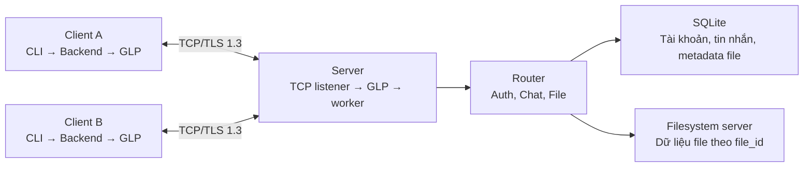
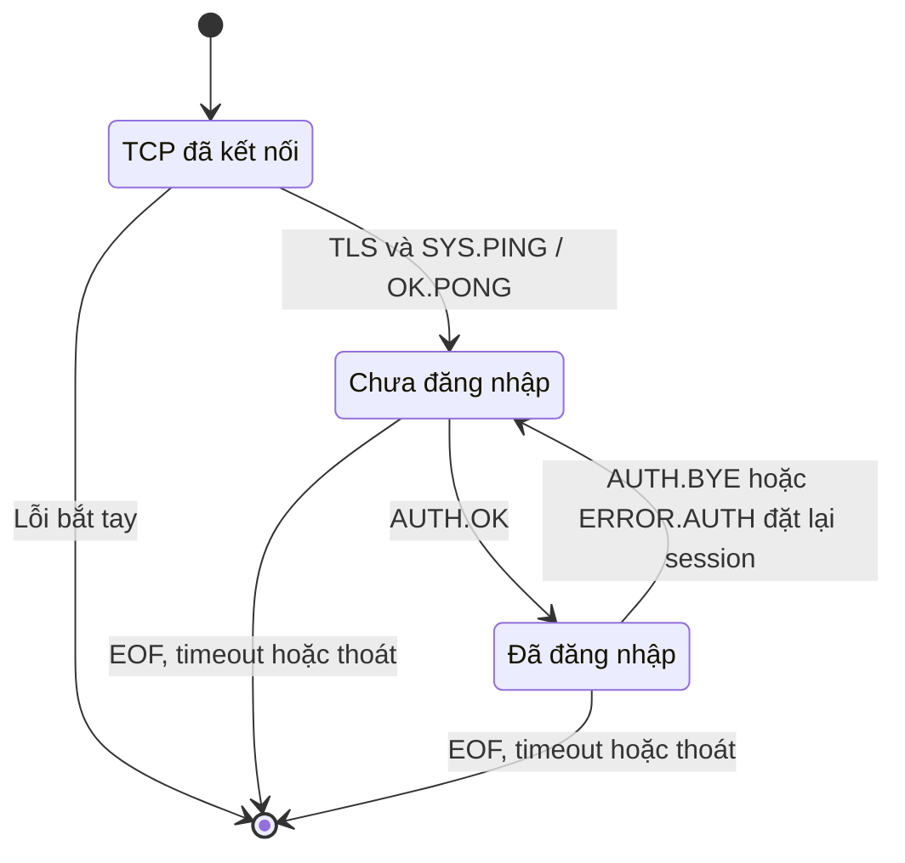
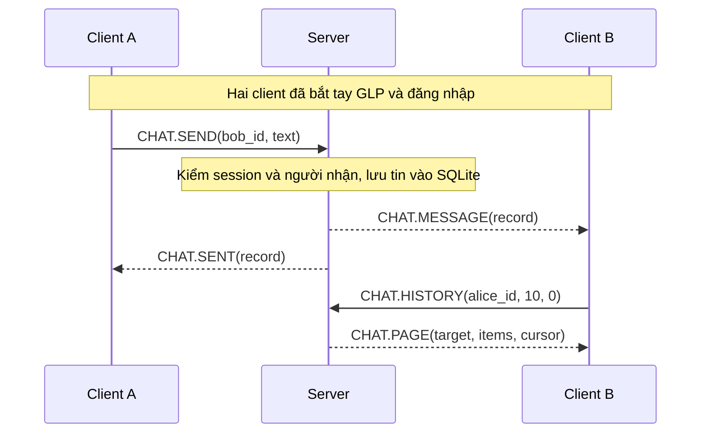
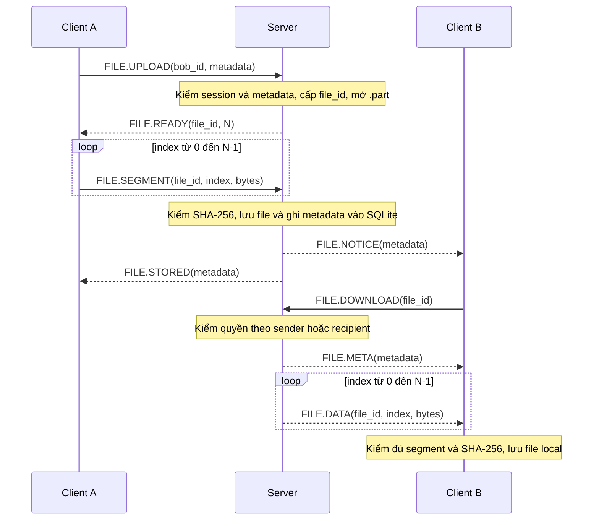

# Distributed Client-Server Collaboration Application

**Báo cáo kỹ thuật GLP**

- **Môn học** Network Application Development
- **Sinh viên** [Họ tên, MSSV]
- **Giảng viên** [Họ tên]
- **Phiên bản nộp** [Commit hoặc mã phiên bản]

## 1. Mục tiêu và phạm vi

Ứng dụng phục vụ nhóm học tập và nhóm nội bộ cần trao đổi tin nhắn, xem trạng thái online và chia sẻ file trong LAN. Một server tự quản lý tài khoản, phiên và dữ liệu. Các client giao tiếp qua server bằng GLP, một giao thức tầng ứng dụng chạy trên TCP/TLS. Bản triển khai dùng Python, socket trực tiếp, SQLite và CLI.

Phạm vi báo cáo là bản demo `TUI-Chat-App`. Client nhập địa chỉ server và lấy danh sách online qua `CHAT.LIST`. UDP discovery/broadcast presence là phần còn thiếu của đề.

## 2. Kiến trúc hệ thống



*Hình 1. Thành phần và kênh giao tiếp của hệ thống.*

| Thành phần | Trách nhiệm |
| --- | --- |
| `client_cli.py` | Đọc lệnh từ stdin. In tin nhắn, trạng thái online/offline, lỗi và tiến độ file ra stdout. |
| `client_backend.py` | Cung cấp API đăng nhập, chat và file cho CLI. Gửi request GLP, xử lý response thành `Result` và chuyển thông báo đến CLI qua callback. |
| `GLP.py`, `GLPConn.py`, `Error.py` | Định nghĩa frame, đóng gói, bọc socket bằng TLS, đọc stream và chuẩn hóa thông báo lỗi. |
| `server.py`, `router.py` | Nhận kết nối, phân worker và gọi `dispatch()` để kiểm route, số arg, session rồi chuyển request đến service. |
| `auth.py`, `chat.py`, `files.py`, `db.py` | Quản lý phiên, định tuyến tin, kiểm quyền file và lưu dữ liệu. `file_transfer.py` dùng chung ở hai phía để chia và ghép file. |

Server dùng `ThreadPoolExecutor` với 20 worker mặc định. Listener hoàn tất bắt tay TLS và GLP trước khi giao kết nối cho worker. `app_lock` bảo vệ SQLite và trạng thái dùng chung. Client có một luồng đọc và một luồng heartbeat để nhận thông báo khi CLI đang chờ nhập.

## 3. Đặc tả giao thức GLP

### 3.1. Cấu trúc frame và parser

Request và response dùng chung cấu trúc bên dưới. GLP lấy ý tưởng về header phân dòng và body có độ dài từ HTTP và giao thức Redis. Dòng thứ hai là route ở request hoặc action ở response, đều có dạng `TYPE.ACTION`.

```text
GLP\r\n
route_or_action\r\n
session\r\n
\r\n
argc\r\n
length_1\r\n
<đúng length_1 byte>\r\n
... lặp cặp length và dữ liệu cho đủ argc arg
```

Header, `argc` và các trường độ dài dùng ASCII. Arg có thể chứa UTF-8, JSON hoặc bytes file. Độ dài tính theo **byte**. Ví dụ dưới gửi tin `Chào` lên chat chung bằng token minh họa. Chuỗi UTF-8 `Chào` dài 5 byte.

```text
GLP\r\n
CHAT.SEND\r\n
0123456789abcdef0123456789abcdef\r\n
\r\n
2\r\n
6\r\n
GLOBAL\r\n
5\r\n
Chào\r\n
```

`Request.to_bytes()` và `Response.to_bytes()` đóng gói frame trước khi `sendall()` ghi vào socket. `recv()` đọc vào buffer của kết nối. `_parse()` kiểm tra magic, header, `argc` và từng độ dài. Khi thiếu byte, parser trả `None` để đọc thêm. Khi đủ frame, parser lấy đúng số byte của frame đó và giữ phần dư. Frame sai hoặc EOF giữa frame sinh `ProtocolError`. Giới hạn là 64 byte mỗi dòng header, 4 arg, 64 KiB mỗi arg và 256 KiB mỗi frame.

### 3.2. Bắt tay, phiên và bảo mật

`GLP_Connection.connect(host, port)` mở TCP và bắt tay TLS. `GLP_Connection.accept(sock)` xử lý phía server. Client gửi `SYS.PING` với `DEFAULT_SESSION`, server trả `OK.PONG` để xác nhận đã nói đúng GLP. Sau khi login hoặc register thành công, `AUTH.OK` mang token mới ở header và hồ sơ người dùng ở body.

| Giá trị session | Ý nghĩa |
| --- | --- |
| `_THIS_IS_THE_DEFAULT_SESSION_ID_` | Chưa đăng nhập. Response có thể dùng marker này để đưa client về trạng thái chưa đăng nhập. |
| 32 ký tự hex thường | Token tạo từ 16 byte ngẫu nhiên. Server giữ token trong RAM, gắn với user ID, kết nối, IP và thời hạn 12 giờ. |
| `_YOU_DO_NOT_CHANGE_YOUR_SESSION_` | Marker trong response yêu cầu client giữ session hiện tại. |



*Hình 2. Các trạng thái của một kết nối GLP.*

TLS 1.3 mã hóa từng đường truyền client–server. Server đọc cert và private key từ `server.pem` một lần rồi dùng chung TLS context. Client dùng `CERT_NONE` và tắt kiểm tra hostname theo giả định tin cậy server đã biết. Server đọc được dữ liệu để định tuyến và dùng SHA-256 có salt để lưu giá trị kiểm tra mật khẩu trong SQLite.

### 3.3. Route và action

| Request | Args theo thứ tự | Response hoặc sự kiện |
| --- | --- | --- |
| `SYS.PING` | 0 arg | `OK.PONG` |
| `AUTH.REGISTER`, `AUTH.LOGIN` | username, password | `AUTH.OK(profile)` và token trong header |
| `AUTH.LOGOUT` | 0 arg | `AUTH.BYE` và `DEFAULT_SESSION` |
| `CHAT.LIST` | 0 arg | `CHAT.ITEMS(items)` gồm chat chung và người dùng kèm trạng thái |
| `CHAT.SEND` | target, text | `CHAT.SENT(record)` cho bên gửi và `CHAT.MESSAGE(record)` cho kết nối online được phép nhận |
| `CHAT.HISTORY` | target, limit tùy chọn, before tùy chọn | `CHAT.PAGE(target, items, cursor)` |
| `FILE.UPLOAD` | target, metadata JSON | `FILE.READY(file_id, N)` hoặc `FILE.STORED(metadata)` nếu file rỗng |
| `FILE.SEGMENT` | file_id, index, bytes | `FILE.STORED(metadata)` ở segment cuối hợp lệ. `FILE.NOTICE(metadata)` báo file mới cho các kết nối liên quan. |
| `FILE.LIST` | target, cursor | `FILE.ITEMS(target, items, cursor)` |
| `FILE.DOWNLOAD` | file_id | `FILE.META(metadata)` rồi đúng `N` frame `FILE.DATA(file_id, index, bytes)` khi thành công |
| `FILE.CANCEL` | file_id của upload đang dở | `FILE.CANCELLED(file_id)` |

`target` là `GLOBAL` hoặc ID người nhận. `ERROR.AUTH`, `ERROR.CLIENT` và `ERROR.FILE` mang một arg UTF-8 có tiền tố `[!]`. Khi token hết hạn hoặc sai kết nối ở một route cần xác thực, server trả `ERROR.AUTH` với `DEFAULT_SESSION`.

## 4. Sơ đồ trình tự

### 4.1. Vòng đời một tin nhắn



*Hình 3. Gửi tin riêng và truy vấn lại lịch sử.*

`CHAT.SENT` xác nhận server đã lưu tin. Với `GLOBAL`, server đẩy sự kiện đến các kết nối online khác. Với chat riêng, sự kiện giới hạn ở các kết nối liên quan đến người gửi và người nhận. CLI hiện 10 tin gần nhất của cả hai phía khi vào chat và dùng cursor để lấy tin cũ hơn.

### 4.2. Vòng đời một file

`FileMetadata` gồm `name`, `size`, `segments` và `sha256`. Mỗi segment có tối đa 32 KiB và index bắt đầu từ 0. Tổng số segment `N = (size + 32767) // 32768`. Ví dụ file 70.000 byte có ba segment dài 32.768, 32.768 và 4.464 byte. Giới hạn hiện tại là 1 GiB mỗi file.



*Hình 4. Upload rồi download một file riêng có dữ liệu.*

1. **Khai báo upload.** Client đọc nguồn theo block để tính SHA-256 rồi quay về đầu file. Server kiểm metadata, tạo `file_id` và gắn upload dở với session và kết nối.
2. **Nhận và lưu ở server.** Sau `FILE.READY`, client gửi liên tiếp `N` segment
   theo thứ tự trên TCP. Hai mốc xác nhận của GLP là sẵn sàng và đã lưu.
   `SegmentWriter` kiểm index và byte length, ghi vào `.part` và cập nhật hash.
   Khi đủ dữ liệu, server kiểm hash, đổi tên file theo ID và ghi metadata vào
   SQLite rồi trả `FILE.STORED`.
3. **Tải và ghép ở client.** Với file riêng, server đối chiếu người yêu cầu với
   người gửi hoặc người nhận. Với file `GLOBAL`, tài khoản đã xác thực có thể tải.
   Client đọc đúng `N` segment theo metadata, đối chiếu file ID, thứ tự, kích
   thước và hash. Sau khi kiểm xong, client dùng `os.link()` để công bố tên file
   đích. Nếu tên đã tồn tại, client thử tên có hậu tố.

File rỗng có `N = 0`. Upload sẽ trả `FILE.STORED` ngay khi kiểm hash rỗng thành công. Download hoàn tất từ `FILE.META` và kết quả kiểm hash ở client.

## 5. Thách thức và giải pháp

1. **TCP chia hoặc gộp dữ liệu khi đọc.** Một lần `recv()` có thể trả về một phần frame hoặc nhiều frame. Body dùng byte length để parser đọc đủ arg, kể cả khi bytes file có CRLF. Buffer theo kết nối giữ phần chưa hoàn chỉnh, còn giới hạn frame chặn header hoặc payload quá lớn. Test kiểm các vị trí tách frame, frame ghép và EOF giữa frame.
2. **Chat và heartbeat xen giữa luồng file.** Client có một reader để phân loại `OK.PONG`, sự kiện và response của giao dịch hiện tại. Send lock bảo vệ từng frame. Server dùng thread riêng để stream download để worker tiếp tục đọc PING. Queue giới hạn hai frame giúp kiểm soát dữ liệu đang chờ xử lý. Listener bắt tay tuần tự và `app_lock` dùng chung vẫn có thể làm client khác chờ khi một kết nối chậm.
3. **Mất kết nối hoặc response đến muộn.** Client gửi PING mỗi 15 giây. Server và client đóng kết nối khi thiếu PING hoặc PONG trong 60 giây. Khi chờ một response nghiệp vụ quá 15 giây, client đóng kết nối để response trễ không bị gán cho giao dịch sau. Server dọn session, online state và upload dở khi phát hiện EOF hoặc timeout.
4. **File lỗi hoặc ghi dở.** Hai phía ghi từng segment vào `.part` và hash tăng dần để kiểm nội dung mà chỉ cần giữ từng block. Tên đích xuất hiện sau khi kiểm đủ segment và SHA-256. Nếu INSERT metadata lỗi, server xóa file đã đổi tên. Crash giữa đổi tên và INSERT vẫn có thể để lại file thiếu bản ghi. Các giới hạn còn lại là quota tổng, deadline cho tiến độ transfer và resume.

## 6. Kiểm thử và đối chiếu rubric

**Môi trường đã chạy** macOS 15.7.3, Python 3.15.2, TCP loopback.

- `python3 -B test-server.py` đạt **36/36**. Bộ test kiểm framing, auth, chat global/private, file rỗng và nhiều segment, quyền file, hash sai, đứt kết nối và heartbeat.
- Một lượt chạy listener thật với **20 client TLS 1.3 đồng thời** trên localhost. Cả 20 đăng nhập thành công, mỗi client thấy 19 tài khoản còn lại online và một tin `GLOBAL` đến đủ 19 người nhận. Kịch bản dùng tài khoản và SQLite tạm.
- **Minh chứng bổ sung cho bản PDF** [Ảnh hoặc log từ các terminal chạy server và client]. Nếu chạy qua LAN, ghi OS của từng máy, số client, thao tác thử và kết quả thực tế. Kết quả loopback hiện tại chỉ xác nhận kịch bản trên một máy.

| Bước trong đề | Đối chiếu với bản demo |
| --- | --- |
| 1. Setup & Protocol Design | Frame, route và trạng thái ở Mục 3. [Bổ sung bản phác thảo hoặc commit trước triển khai để chứng minh trình tự thiết kế.] |
| 2. TCP Handshake | TCP/TLS rồi `SYS.PING` → `OK.PONG`. |
| 3. Concurrency | Thread pool và bằng chứng 20 kết nối đồng thời trên loopback. Độ trễ khi nhiều client truyền file đồng thời cần đo thêm. |
| 4. Authentication & State | Username/password, token gắn kết nối, IP trong session và tài khoản online. Cổng TCP của peer xuất hiện trong log. Lưu active port theo session còn thiếu. |
| 5. Real-Time Text Routing | `CHAT.SEND` định tuyến global/private và đẩy `CHAT.MESSAGE`. |
| 6. Reliable File Transfer | Metadata, chunking, reassembly và kiểm hash ở Mục 4.2. |
| 7. Resilience & Error Handling | Heartbeat TCP, timeout, EOF, broken pipe và dọn trạng thái. |
| 8. Security Layer | TLS 1.3 trên từng kết nối theo mô hình server đã biết. |
| 9. UI/CLI Integration | Tin nhắn ra stdout, danh sách online/offline và thanh tiến độ theo số segment. |
| 10. Testing & Code Quality | Suite 36 test trên macOS và các module tách trách nhiệm. [Bổ sung minh chứng nhiều terminal và kết quả LAN hoặc OS khác nếu đã thử.] |

<!-- Khi chuyển sang LaTeX, dùng các mục trên làm section/subsection. Xuất bốn sơ đồ Mermaid thành hình, dùng figure và label/ref cho chú thích và tham chiếu. Giữ ví dụ wire format trong verbatim hoặc lstlisting. Thay các ô trong ngoặc vuông bằng thông tin và minh chứng của bản nộp. -->
