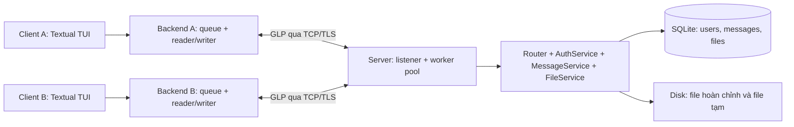
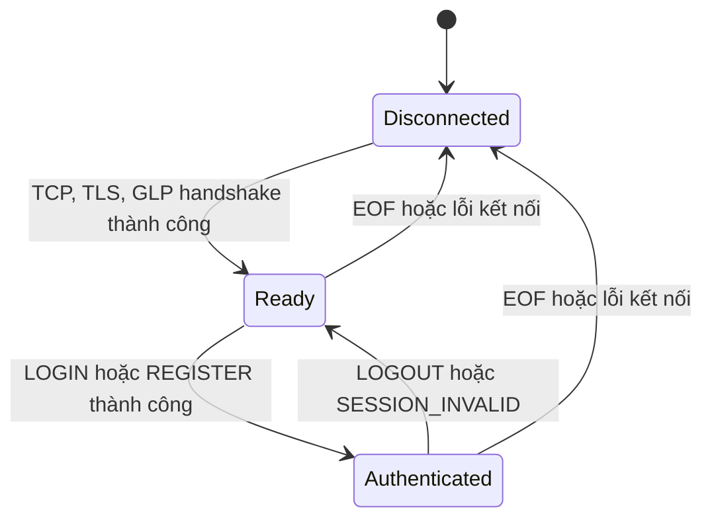
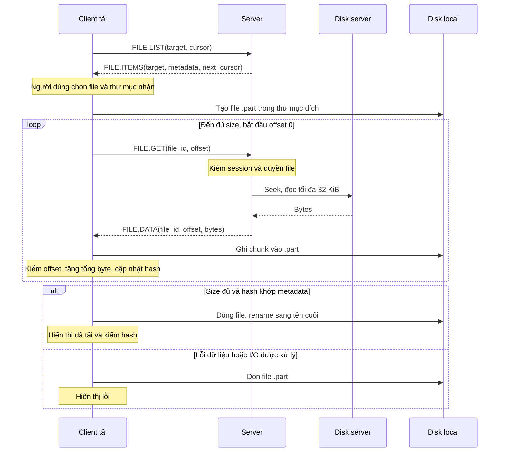

# GLP — Tài liệu kỹ thuật server/client và bản nền báo cáo

**Đối tượng mô tả:** source trong `demo/app`.  
**Ngày đối chiếu source và tài liệu tham khảo:** 09/11/2026.  
**Mục đích:** giải thích implementation để người học sửa, bảo vệ thiết kế và phát triển thành báo cáo môn học.  
**Trạng thái:** bản thảo kỹ thuật dựa trên source; milestone học tập vẫn EXPERIMENT.

Tài liệu phân biệt ba loại phát biểu:

- **Đang có trong source:** có thể chỉ ra module/hàm thực hiện hành vi đó.
- **Đã có evidence:** có kết quả kiểm thử được lưu, kèm phạm vi của lần kiểm thử.
- **Cần bổ sung:** chưa implement, còn giới hạn hoặc chưa có số liệu chứng minh.

Không tự quy đổi thành điểm số hoặc kết luận đạt trọn 10/10. Một tính năng chạy trên loopback chưa chứng minh khả năng chạy LAN, khác hệ điều hành hay phục vụ 20 người dùng. Tài liệu viết sau implementation cũng không tự chứng minh yêu cầu thiết kế giao thức **trước khi code**.

Trong lần viết này chỉ cập nhật `TECHDOCS.md`; không sửa code, database, file người dùng, certificate/private key hoặc đề Word. Các tên, token và nội dung wire example bên dưới là dữ liệu minh họa.

## Mục lục

1. [Phạm vi và yêu cầu gốc](#1-phạm-vi-và-yêu-cầu-gốc)
2. [Cơ sở mạng máy tính](#2-cơ-sở-mạng-máy-tính)
3. [Kiến trúc và tổ chức source](#3-kiến-trúc-và-tổ-chức-source)
4. [Giao thức ứng dụng GLP](#4-giao-thức-ứng-dụng-glp)
5. [Chi tiết từng module server](#5-chi-tiết-từng-module-server)
6. [Chi tiết từng module client](#6-chi-tiết-từng-module-client)
7. [Luồng xử lý và sơ đồ trạng thái](#7-luồng-xử-lý-và-sơ-đồ-trạng-thái)
8. [Lưu trữ và tính nhất quán dữ liệu](#8-lưu-trữ-và-tính-nhất-quán-dữ-liệu)
9. [Lựa chọn thiết kế và giới hạn hiệu năng](#9-lựa-chọn-thiết-kế-và-giới-hạn-hiệu-năng)
10. [Vấn đề có thể gặp và nguyên nhân](#10-vấn-đề-có-thể-gặp-và-nguyên-nhân)
11. [Đối chiếu đủ 10 tiêu chí của đề](#11-đối-chiếu-đủ-10-tiêu-chí-của-đề)
12. [Evidence và kế hoạch kiểm thử](#12-evidence-và-kế-hoạch-kiểm-thử)
13. [Cài đặt, chạy và demo](#13-cài-đặt-chạy-và-demo)
14. [Chuyển thành báo cáo chính thức](#14-chuyển-thành-báo-cáo-chính-thức)
15. [Thuật ngữ và nguồn tham khảo](#15-thuật-ngữ-và-nguồn-tham-khảo)

## 1. Phạm vi và yêu cầu gốc

### 1.1. Bài toán

GLP là ứng dụng cộng tác gồm một server và nhiều client. Server đăng ký/đăng nhập tài khoản, giữ session, cung cấp danh sách online, lưu và chuyển tin nhắn, nhận/lưu/phục vụ file. Client cung cấp TUI — giao diện terminal — để người dùng tương tác.

Mọi text và file đều đi qua server. Đây là kiến trúc client–server tập trung trong một ứng dụng phân tán trên nhiều process/máy; chưa có định tuyến P2P hoặc cơ chế thay thế server khi server dừng.

Nguồn yêu cầu là đề *Distributed Client-Server Collaboration Application*, bản trích ở [assignment-source.txt](../../network-workbench/01-course/docs/assignment-source.txt). Quyết định phạm vi môn học ở [product-baseline.md](../../network-workbench/01-course/docs/product-baseline.md) được dùng để hiểu mục tiêu; mô tả implementation phải theo source của **bản này**.

### 1.2. Các ràng buộc cần phân biệt

| Nội dung | Yêu cầu/mục tiêu | Bản `demo/app` hiện tại |
|---|---|---|
| Mạng trực tiếp | Socket API; không HTTP framework/WebSocket | Dùng `socket`, `ssl`, GLP riêng |
| Text và file | TCP, có phân loại message và chia/ghép file | Có trên TCP/TLS |
| UDP | Discovery/heartbeat broadcast được nêu trong đề | Chưa có socket UDP trong bản này |
| Đồng thời | Mục tiêu server phục vụ 10–20 client | Có thread pool 20 worker; chưa có evidence tải 20 user |
| Authentication | Server xác minh đăng nhập, theo dõi user/IP/port | Có account, session và IP; chưa có registry trường port rõ ràng |
| Security | Dùng thư viện crypto chuẩn để bảo vệ truyền dữ liệu | Có TLS; backend TUI đang tắt kiểm certificate/hostname |
| UI | CLI hoặc GUI, hiển thị message/progress/online | Có Textual TUI |
| OS | Chạy localhost hoặc IP local trên OS thông dụng | Evidence đã lưu trên macOS; chưa xác nhận cross-OS |
| Hồ sơ nộp | Source, README, báo cáo PDF, protocol/sequence/challenges | Có source/docs; tài liệu này là nền để viết báo cáo PDF |

Không lấy các đặc tính của `demo/python-app` hoặc lab auth khác để điền vào bảng trên. Ví dụ, **password của `demo/app` dùng SHA-256 kèm salt, không phải scrypt**; UDP của một demo khác không đồng nghĩa bản này đã có UDP.

### 1.3. Tình trạng entrypoint cần biết

[app.py](app.py) nhận ba mode `server`, `client`, `hacker`. Nhánh `server` gọi `start_server()`. Tuy nhiên, trong source được đọc ngày 09/11/2026, cả `client` và `hacker` đều đi vào nhánh khởi tạo `GLPApp`.

[client/hacker.py](client/hacker.py) vẫn định nghĩa `HackerApp` và các lớp giao diện riêng. Tests UI khởi tạo trực tiếp lớp này. Vì vậy phải phân biệt:

- Lớp skin hacker tồn tại và có evidence headless.
- Lệnh CLI mode `hacker` hiện chưa chọn lớp đó.

Một số mô tả trong README/docstring cũ chưa phản ánh thay đổi entrypoint này. Tài liệu này ghi nhận sự khác biệt, không tự sửa source.

## 2. Cơ sở mạng máy tính

### 2.1. Các lớp dữ liệu trên đường truyền

```text
Nội dung người dùng: text / metadata / bytes file
           ↓
GLP frame: magic + route/action + session + argc + lengths + args
           ↓
TLS records: mã hóa và bảo vệ tính toàn vẹn của kênh
           ↓
TCP byte stream: vận chuyển có thứ tự, truyền lại khi cần
           ↓
IP và mạng liên kết bên dưới: loopback / Ethernet / Wi-Fi / VPN
```

GLP là giao thức **tầng ứng dụng** của bài. Trong tài liệu, “frame GLP” hay “gói ứng dụng” chỉ đơn vị do chương trình định nghĩa; nó không nhất thiết trùng với một TCP segment, TLS record hoặc frame Ethernet.

TCP cung cấp luồng byte có thứ tự và cơ chế truyền lại; nó không cung cấp sẵn ranh giới message của GLP. Vì vậy bên nhận vẫn cần parser xác định từng frame. Tính hai chiều của TCP cho phép dùng cùng connection cho request, response và event server đẩy xuống. Nguồn: [RFC 9293, mục 2.2](https://www.rfc-editor.org/rfc/rfc9293.html#section-2.2).

### 2.2. Socket, IP, port và connection

Server tạo socket `AF_INET/SOCK_STREAM`, nghĩa là listener IPv4/TCP. `bind()` gắn địa chỉ local; `listen()` đưa socket vào chế độ chờ; `accept()` trả về một socket riêng cho connection mới. Listener không phải socket dùng để gửi nội dung chat của từng user.

Một TCP connection được phân biệt bằng địa chỉ/port hai đầu cùng giao thức. Server có thể dùng chung một listening port, còn mỗi client có source port riêng do OS chọn. Nhiều client cùng IP vẫn có thể có connection và account khác nhau.

IP/port chỉ nhận diện endpoint mạng trong bối cảnh connection, không chứng minh danh tính người dùng. Identity của bài được xác minh bằng account/password rồi bind vào session.

`listen(20)` mô tả backlog — hàng đợi kết nối chờ được accept trong giới hạn OS áp dụng — không có nghĩa đã xác thực 20 user hoặc xử lý hiệu quả 20 session. `max_workers=20` lại là giới hạn worker hoạt động, là một khái niệm khác. Nguồn: [Python socket](https://docs.python.org/3.12/library/socket.html#socket.socket.listen), [ThreadPoolExecutor](https://docs.python.org/3.12/library/concurrent.futures.html#threadpoolexecutor).

### 2.3. Vì sao `sendall()` không thay thế framing?

`sendall()` cố gửi hết buffer hoặc báo lỗi. Nó không tạo một ranh giới message mà phía `recv()` phải giữ nguyên. Một lần nhận có thể chỉ có một phần header, một phần body, một frame hoàn chỉnh hoặc nhiều frame nối nhau.

Do đó không thể suy luận `recv(4096)` luôn trả 4096 byte, cũng không thể lấy một lần `recv()` làm một message. 4096 ở đây chỉ là kích thước đọc tối đa mỗi lần gọi trong code. Parser phải giữ phần chưa đủ và phần dư của stream.

`recv()` trả bytes rỗng biểu thị peer đóng phía gửi của stream theo API; reset, timeout hoặc lỗi TLS còn có thể xuất hiện dưới dạng exception. Hoàn tất `sendall()` cũng chưa chứng minh application bên kia đã lưu DB hoặc ghi file. Nguồn: [Socket Programming HOWTO](https://docs.python.org/3.12/howto/sockets.html#using-a-socket), [socket.sendall](https://docs.python.org/3.12/library/socket.html#socket.socket.sendall).

### 2.4. Ba lớp “bắt tay” khác nhau

| Lớp | Mục tiêu | Dấu hiệu trong ứng dụng |
|---|---|---|
| TCP connection establishment | Tạo connection vận chuyển | `connect()`/`accept()` thành công |
| TLS handshake | Thiết lập tham số và khóa bảo vệ kênh | `wrap_socket()` hoàn tất theo policy TLS |
| GLP handshake | Kiểm tra peer nói giao thức ứng dụng mong đợi | `SYS.PING` → `OK.PONG` |

GLP PING không thay thế TCP/TLS handshake và không đăng nhập user. TLS handshake cũng không tự đăng nhập account ứng dụng, vì server hiện không yêu cầu client certificate để ánh xạ account.

### 2.5. TLS, authentication và E2EE

TLS bảo vệ các byte GLP trong từng connection client–server. Server giải mã để xử lý nghiệp vụ rồi mã hóa lại trên connection tới người nhận. Vì vậy server đọc được text và file; đây **không phải E2EE** giữa hai client.

Backend TUI đặt `check_hostname=False` và `verify_mode=CERT_NONE`. Kênh có mã hóa, nhưng client chưa xác minh server bằng certificate/hostname, nên không thể mô tả là đã bảo vệ đầy đủ trước một đối tượng chủ động giả mạo server.

Tests TLS có client context riêng kiểm CA/hostname của certificate tạm. Việc test đó pass không thay đổi policy của backend TUI. Nguồn: [RFC 8446](https://www.rfc-editor.org/rfc/rfc8446.html), [Python `CERT_NONE`](https://docs.python.org/3.12/library/ssl.html#ssl.CERT_NONE).

### 2.6. TCP liveness, app heartbeat và UDP discovery

Một connection tồn tại trong state local không chứng minh peer vẫn chạy tốt. Mất mạng im lặng có thể cần hoạt động I/O hoặc deadline để phát hiện. Backend hiện có PING tầng ứng dụng mỗi 10 giây sau login, cùng poll danh sách user mỗi 5 giây; cả hai đi trên TCP.

UDP là transport datagram riêng, không tự bảo đảm giao đúng thứ tự hoặc truyền lại. Discovery broadcast giúp tìm endpoint dịch vụ; nó không xác minh account hay cấp session. Bản này **chưa implement UDP discovery/heartbeat**. Nếu bổ sung sau, cần giới hạn kích thước/tần suất và xác thực qua TCP/TLS/login trước khi coi một user là online. Nguồn: [RFC 768](https://www.rfc-editor.org/info/rfc768/), [RFC 8085](https://www.rfc-editor.org/rfc/rfc8085.html).

### 2.7. RTT được hiển thị có ý nghĩa gì?

Giá trị `ping_ms` lấy thời gian từ lúc client xếp request `SYS.USERS` đến lúc xử lý response `OK.USERS`. Nó gồm thời gian hàng đợi, vận chuyển, xử lý server và lịch event loop; không phải phép đo thuần TCP RTT, ICMP ping hay khoảng cách vật lý.

Client dùng `time.monotonic()` để đo khoảng thời gian. Nếu nhiều request USERS cùng chờ, `_poll_t0` có thể bị lần mới ghi đè, nên phép đo hiện tại chỉ mang tính chỉ báo UI, chưa là công cụ đo chuẩn. Nguồn về clock: [Python `time.monotonic`](https://docs.python.org/3.12/library/time.html#time.monotonic).

## 3. Kiến trúc và tổ chức source

### 3.1. Sơ đồ tổng thể



Mỗi client chủ động kết nối tới server. Không có socket client A → client B trong luồng text/file của bản này. “GLOBAL broadcast” thực hiện bằng nhiều lần gửi unicast trên các connection TCP đang online, không phải IP broadcast.

### 3.2. Cây module chính

```text
demo/app/
├── app.py                      entrypoint CLI
├── GLP.py                      model Request/Response, encoder, allowlist
├── GLPConn.py                  socket/TLS adapter và stream parser
├── file_protocol.py            tên action, kích thước và basename FILE
├── server/
│   ├── server.py               khởi tạo dịch vụ, listener, worker, cleanup
│   ├── router.py               dispatch route và tạo response/event
│   ├── auth.py                 account/session nghiệp vụ, online registry
│   ├── db.py                   schema users/messages và SQL helpers
│   ├── chat.py                 MessageService
│   ├── files.py                FileService, Upload, FileConnection
│   └── config.py               AppError
├── client/
│   ├── client.py               GLPApp: nối network event với state/UI
│   ├── client_backend.py       kết nối TLS, queue gửi, reader/writer thread
│   ├── client_state.py         ChatState, Peer, Entry, lịch sử/unread
│   ├── client_screens.py       login, main chat, đổi tên
│   ├── client_widgets.py       các widget hiển thị
│   ├── client_theme.py         màu, xử lý ký tự và độ rộng terminal
│   ├── client_files.py         controller gửi/tải file theo từng chunk
│   ├── file_ui.py              FileBar và FileScreen
│   └── hacker.py               các lớp skin HackerApp
└── tests/                      unit, TCP/TLS integration, headless UI
```

Các thư mục `server/files/`, `downloads/` và các file DB/WAL/SHM là dữ liệu runtime, không phải module source cần dùng làm mẫu implementation.

### 3.3. Ranh giới trách nhiệm thực tế

- **Wire/transport:** `GLP.py`, `GLPConn.py`, `client_backend.py`.
- **Nghiệp vụ server:** `router.py`, `auth.py`, `chat.py`, `files.py`.
- **Storage:** SQL helpers và file disk trên server.
- **State/UI client:** `ChatState`, `GLPApp`, screens/widgets và controller FILE.

Sự tách lớp là tương đối: router vẫn query SQL trực tiếp và push event qua connection; `client_files.py` vẫn đọc/ghi một chunk disk trên thread UI khi xử lý response. Không nên viết báo cáo rằng toàn bộ nghiệp vụ độc lập tuyệt đối với I/O, hoặc toàn bộ I/O file đều ở worker nền.

## 4. Giao thức ứng dụng GLP

Nguồn implementation: [GLP.py](GLP.py), [GLPConn.py](GLPConn.py), [file_protocol.py](file_protocol.py), [router.py](server/router.py), [files.py](server/files.py).

### 4.1. Cấu trúc frame

Request:

```text
GLP\r\n
TYPE.ACTION\r\n
session_id\r\n
\r\n
argc\r\n
length_0\r\n
<đúng length_0 byte của arg_0>\r\n
... lặp đủ argc args ...
```

Response/event có cùng body, nhưng dòng thứ hai là `action` và dòng thứ ba là `session_update`.

Trong sơ đồ trên, `\r\n` biểu diễn hai byte CR LF, không phải bốn ký tự backslash/r/backslash/n. Không gửi dòng dấu `...`; nó chỉ diễn tả phần lặp. Không cần marker END vì số arg và byte length xác định điểm kết thúc frame.

| Trường | Ý nghĩa/encoding |
|---|---|
| Magic | Literal `b"GLP\r\n"`, dài 5 byte |
| Route request | Một route dạng `TYPE.ACTION`; không có HTTP method |
| Action response | Kết quả hoặc event, ví dụ `OK.AUTH`, `EVT.RECV`, `FILE.DATA` |
| Session request | Token 32 lowercase hex hoặc default marker chưa-auth |
| Session update | `-` giữ session hiện tại; token mới thay token; default marker đưa về chưa-auth |
| `argc`, `length` | Encoder phát số thập phân ASCII; length tính theo **byte** |
| Args | Text/JSON UTF-8 hoặc binary tùy route; không decode tất cả như text |

Default marker là `_THIS_IS_THE_DEFAULT_SESSION_ID_`, đúng 32 ASCII byte. Nó là giá trị quy ước cho trạng thái chưa-auth, không phải session dùng chung để nhận diện mọi client.

### 4.2. Vì sao body dùng length thay vì split theo CRLF?

Header là metadata có cấu trúc nên có thể tìm dòng trống. Nhưng bytes file có thể chứa CRLF, `GLP`, byte NUL hoặc bất kỳ giá trị byte nào. Split toàn body theo CRLF sẽ làm sai dữ liệu hoặc mất ranh giới arg.

Ví dụ text `Xin chào` có 8 ký tự Unicode nhưng **9 byte UTF-8**. Encoder đã được đối chiếu cho ra:

```python
b'GLP\r\nMSG.GLOBAL\r\naaaaaaaaaaaaaaaaaaaaaaaaaaaaaaaa\r\n\r\n1\r\n9\r\nXin ch\xc3\xa0o\r\n'
```

Chuỗi `a` lặp 32 lần chỉ là token ví dụ. Ví dụ trên mô tả encoding; một server thật chỉ chấp nhận token đã cấp và bind với đúng connection.

### 4.3. Giới hạn encoder và giới hạn parser không giống nhau

| Giới hạn | Encoder đang kiểm | Parser nhận đang làm |
|---|---|---|
| Header line | `MAX_LINE=64` byte, ASCII, không CR/LF nhúng | Decode header, yêu cầu 2 dòng; không áp đầy đủ kiểm ASCII/64 byte tương đương |
| Số args | `MAX_ARGS=4` | Đọc `argc` bằng `int`; chưa áp cap 4 và kiểm số không âm đầy đủ |
| Một arg | `MAX_ARG=65536` byte | Đọc length rồi chờ đủ; chưa áp cap 65536 tương đương |
| Frame | `MAX_FRAME=262144` byte | Chưa áp cap tổng frame/buffer tương đương |
| Header chưa hoàn chỉnh | Encoder không sinh header lỗi | Nếu chưa có dòng trống và buffer vượt 4096 byte thì báo lỗi |
| Valid route/action/session | `to_bytes()` gọi `validate()` | Parser tạo object nhưng không gọi lại `validate()` |

Vì vậy đây là **giới hạn được encoder của client hợp lệ tuân thủ**, chưa là bằng chứng mọi đầu vào mạng đều bị chặn theo cùng giới hạn. Bài báo cáo phải nêu đây là phần cần hoàn thiện validation tại biên nhận; không gọi parser hiện tại là đã được harden đầy đủ.

### 4.4. Cách parser hoạt động

`recv()` gọi `_parse()` trước. Nếu chưa đủ frame, nó đọc thêm tối đa 4096 byte từ TLS socket vào `bytearray`, rồi thử lại.

`_parse()` kiểm magic, tìm hết header, đọc argc, lần lượt đọc length và đúng số byte mỗi arg, kiểm CRLF sau arg. Khi đủ frame, nó xóa đúng phần đã tiêu thụ; byte của frame kế tiếp vẫn còn trong buffer.

Nếu dòng thứ hai khớp allowlist `ROUTE`, object trả về là `Request`; nếu không thì tạo `Response`. Đây là quy ước phân loại của implementation, chưa có bit message-kind riêng. Do đó tên response FILE được chọn khác tên request FILE. Route không biết cũng chưa được phân loại/validate chặt chỉ bằng nhánh này.

Khi EOF xảy ra giữa một frame, code báo connection kết thúc, không cố dùng phần frame chưa hoàn chỉnh để thực hiện nghiệp vụ.

### 4.5. Routes SYS, AUTH và DASH

Mỗi phần tử của cột args là một arg bytes riêng. JSON chỉ xuất hiện tại các route có mô tả JSON; không bọc toàn bộ frame bằng JSON.

| Route | Args | Điều kiện | Kết quả chính |
|---|---|---|---|
| `SYS.PING` | không | Không cần session đăng nhập | `OK.PONG`; handshake đầu trả default marker, PING trong router trả `-` |
| `SYS.USERS` | không | Session hợp lệ | `OK.USERS` (JSON list `user_id`, `username`, `dispname`) |
| `AUTH.REGISTER` | username, password, optional display name | Connection chưa có session đang hiệu lực | `REDIRECT.HOME` (user_id), header cấp token; đăng ký xong tự login |
| `AUTH.LOGIN` | username, password | Account đúng, connection chưa login | `REDIRECT.HOME` (user_id), header cấp token |
| `AUTH.LOGOUT` | không | Session hợp lệ | Xóa upload/session/online của connection; `REDIRECT.LOGIN`, header default marker |
| `DASH.HOME` | không | Session hợp lệ | `OK.AUTH` (`Welcome`, user_id) |
| `DASH.SELF` | không | Session hợp lệ | `OK.AUTH` (user_id, username, dispname) |
| `DASH.RENAME` | display name UTF-8 | Session hợp lệ, tên hợp lệ | `OK.PROFILE` (user_id, username, dispname) |

`OK.AUTH` được dùng cho cả HOME và SELF, client phân biệt bằng hình dạng args. Token không được người dùng chọn; server lấy identity từ session.

### 4.6. Routes MSG và event text

| Route | Args | Hành vi | Response |
|---|---|---|---|
| `MSG.GLOBAL` | content UTF-8 | Lưu DB với receiver NULL; push tới các connection online khác sender | `EVT.SENT` (`GLOBAL`) |
| `MSG.PRIVATE` | target user_id, content UTF-8 | Lưu DB; nếu có target connection thì push | `EVT.SENT` (`PRIVATE`, target user_id) |
| `MSG.GETGLO` | không | Đọc lịch sử GLOBAL | `OK.HISTORY` (`GLOBAL`, JSON list) |
| `MSG.GETPRI` | target user_id | Đọc lịch sử hai chiều giữa user đăng nhập và target | `OK.HISTORY` (`PRIVATE`, target user_id, JSON list) |
| `MSG.CHATS` | không | Tìm các đối tác đã có text với user | `OK.CHATS` (JSON list `user_id`, `dispname`) |

Event đến client:

```text
EVT.RECV args = [GLOBAL hoặc PRIVATE, sender_id, sender_name, content]
history item = {sender_id, sender_name, content, time}
```

Tất cả MSG cần session. Sender ID trong event lấy từ session server, không nhận sender ID do client tự khai. `EVT.SENT` là server đã lưu và thực hiện bước gửi theo code, chưa là người nhận đã tải/đọc tin.

### 4.7. Routes FILE và quy ước offset

`target` là literal `GLOBAL` hoặc user ID của đối tác. Với chat riêng, user hiện tại được server lấy từ session, không cần gửi lại trong args. File ID là UUID gồm 32 lowercase hex do server tạo. Offset là số byte tính từ đầu file, bắt đầu từ 0.

| Request | Args | Response |
|---|---|---|
| `FILE.UPLOAD` | target, basename UTF-8, size ASCII | `FILE.READY` (file_id) |
| `FILE.CHUNK` | file_id, offset ASCII, raw bytes | `FILE.ACK` (file_id, next_offset) |
| `FILE.COMPLETE` | file_id, SHA-256 hex | `FILE.STORED` (metadata JSON) |
| `FILE.CANCEL` | file_id | `FILE.CANCELLED` (file_id) |
| `FILE.LIST` | target, cursor ASCII (`0` là trang mới nhất) | `FILE.ITEMS` (target, JSON list, next_cursor hoặc arg rỗng) |
| `FILE.GET` | file_id, offset ASCII | `FILE.DATA` (file_id, offset, raw bytes) |
| `FILE.CHATS` | không | `FILE.PEERS` (JSON list đối tác đã có file riêng) |

Server gửi thêm `FILE.NOTICE` với một arg metadata JSON khi file đã được công bố. File bytes không được nhét vào JSON hoặc Base64.

Một metadata object có các trường lấy từ DB/join:

```text
seq, file_id, sender_id, receiver_id, name, size, sha256, time,
sender_name, receiver_name
```

`receiver_id=null` biểu thị GLOBAL. `sha256` là 64 lowercase hex do `hexdigest()` sinh; server so chuỗi trực tiếp, không tự chuẩn hóa một digest viết uppercase. Đây không phải khóa mã hóa. Các display name từ join phản ánh profile lúc query, không phải bản chụp bất biến của tên lúc gửi.

### 4.8. Mã lỗi và tương quan request/response

| Action | Ý nghĩa thực tế |
|---|---|
| `DENY.AUTH` với `LOGIN_FAILED` | Sai thông tin account/password |
| `DENY.AUTH` với `SESSION_INVALID` | Token thiếu/hết hạn/sai connection; router xóa state auth/online liên quan và header về default |
| `ERROR.CLIENT` | `AppError` nghiệp vụ khác; args gồm code và mô tả |
| `FILE.ERROR` | Lỗi FILE được module bắt; args gồm route và mô tả |
| `ERROR.SERVER`, `ERROR.TIMEOUT` | Có trong allowlist encoder, nhưng không có nghĩa mọi exception/timeout hiện đã được chuyển thành các action này |

GLP chưa có request ID tổng quát. Thread ghi giữ thứ tự request từ queue; server xử lý tuần tự request của mỗi connection, nhưng event có thể xen giữa các response. Client dựa vào action/args, channel key và trạng thái pending của từng chức năng; `_silent` chỉ để giấu response poll, không phải transaction ID.

FILE bổ sung file ID/offset để nhận diện chunk và chỉ cho một transfer tại UI mỗi lúc. Điều đó làm flow FILE dễ theo dõi, nhưng không biến toàn bộ giao thức thành cơ chế tương quan nhiều RPC song song hoàn chỉnh.

## 5. Chi tiết từng module server

### 5.1. `server/server.py` — vòng đời server và connection

Nguồn: [server/server.py](server/server.py).

| Thành phần | Trách nhiệm |
|---|---|
| `generate_tls_keys()` | Nếu thiếu cert hoặc key, gọi OpenSSL tạo self-signed certificate RSA 2048, thời hạn 365 ngày, subject CN localhost |
| `start_server()` | Mở SQLite, tạo services, cấu hình TLS, bind/listen, accept và nộp worker |
| `handle_client()` | Lặp recv → dispatch → send trên một connection; xử lý lỗi và cleanup |
| `app_lock` | Khóa chung khi truy cập state/DB nghiệp vụ và cleanup |

Thứ tự khởi tạo: certificate/key → DB và schema → AuthService/UserManager/MessageService/FileService → TLS context → IPv4 listener → thread pool. Đường dẫn server data lấy theo thư mục module, không theo working directory của terminal.

TLS context đặt phiên bản tối thiểu TLS 1.3. Code không tự viết thuật toán mã hóa và không chỉ định cứng một cipher suite trong phần application; thư viện TLS thương lượng thông số phù hợp. Dòng log “TLS 1.3” là thông báo của code, còn muốn ghi protocol/cipher thương lượng thực tế trong báo cáo thì cần đo từ socket/test.

Sau `accept()`, server gọi `GLP_Connection.accept()` để hoàn tất TLS và GLP PING/PONG, sau đó mới `executor.submit(handle_client, ...)`. Đây là điểm dễ giải thích nhưng có giới hạn: một peer chưa hoàn tất handshake có thể trì hoãn vòng accept của peer sau.

**Phân biệt timeout:** `timeout=30.0` được gán trong constructor GLP connection sau khi `wrap_socket()` hoàn tất. Vì vậy không được viết rằng TLS handshake ở vòng accept chắc chắn đã có deadline 30 giây; source hiện chưa đặt deadline rõ ràng cho accepted raw socket trước bước TLS đó.

Khi FILE được bật, worker bọc connection bằng `FileConnection`, rồi dùng chính object bọc đó làm connection identity trong auth/online/upload. Connection tồn tại cho nhiều request và event, không mở lại cho mỗi tin/chunk.

Trong worker, `recv()` ở ngoài `app_lock`. Các client chờ dữ liệu mạng có thể chờ độc lập. `dispatch()` chạy trong lock; response thông thường được gửi sau khi thả lock. Tuy nhiên push event trong router/FileService còn nằm bên trong dispatch, tức vẫn có thể gửi mạng khi đang giữ lock chung.

Trong `finally`, worker xóa upload dở, session và online entry rồi đóng connection. Cách này giúp một lỗi connection không trực tiếp dừng vòng listener. Chưa có cơ chế shutdown server tổng thể đóng listener/tất cả client/DB và join workers một cách được kiểm chứng.

### 5.2. `server/router.py` — ánh xạ route và nghiệp vụ

Nguồn: [server/router.py](server/router.py).

`dispatch()` nhận Request đã parse cùng các services, object connection và IP. Hàm trả Response; riêng các nhánh chat/file có thể push event tới connection khác trong quá trình xử lý.

Quy trình:

1. Route FILE được đưa tới FileService sau khi kiểm session.
2. Các route khác được kiểm số args qua `ARG_COUNTS`.
3. PING và LOGIN/REGISTER xử lý trước cổng session.
4. Những route còn lại phải qua `auth.get_session(token, connection)`.
5. Chọn nhánh nghiệp vụ, tạo response bằng `reply()`.
6. `AppError` được đổi thành DENY/ERROR phù hợp.

`as_bytes()`/`reply()` thống nhất việc biến dữ liệu nghiệp vụ thành args bytes. Router không tự tách TCP stream; việc đó thuộc GLPConn.

Router hiện vẫn biết online registry, connection gửi event và một số câu SQL profile/history. Đây là cách tập trung luồng xử lý cho bài nhỏ, đổi lại coupling giữa routing/nghiệp vụ/storage còn tương đối cao.

Lỗi không thuộc `AppError`, ví dụ một số lỗi decode/SQLite, chưa chắc có response lỗi hợp thức. Chúng có thể đi lên worker, làm connection bị đóng sau cleanup. Allowlist có tên `ERROR.SERVER` không chứng minh mọi lỗi đã được chuyển thành action đó.

### 5.3. `server/auth.py` — account nghiệp vụ và session

Nguồn: [server/auth.py](server/auth.py).

#### `Session`

Dataclass giữ `token`, `user_id`, `expires`, `connection_id`, `ip_addr`. Session được giữ trong RAM, không lưu vào SQLite. Expiry mặc định là 12 giờ tính từ lúc tạo bằng `time.time()`; không có cơ chế gia hạn trượt sau mỗi request.

Token do `secrets.token_hex(16)` tạo: 16 byte ngẫu nhiên được biểu diễn thành 32 ký tự hex. Chọn nguồn ngẫu nhiên dành cho secret phù hợp hơn bộ sinh dùng mô phỏng. Nguồn: [Python secrets](https://docs.python.org/3.12/library/secrets.html#secrets.token_hex).

Expiry được kiểm khi gọi kiểm session hoặc dọn qua `_available()`, chưa có timer expiry quét registry/push độc lập. Vì event gửi theo online registry, không nên xem mốc TTL là một cơ chế tự động cắt mọi event tới một connection đúng thời điểm đó. Clock của expiry là wall clock; duration UI dùng monotonic clock là một lựa chọn khác.

`user_id` lại do UUID tạo khi đăng ký account, là identity bền trong DB; tên hiển thị có thể đổi. Token session là bí mật tạm thời, không phải user ID hoặc địa chỉ mạng.

#### `AuthService`

| Hàm | Hành vi chính |
|---|---|
| `_user_account()` | Username/password ASCII printable, độ dài 8–32 byte |
| `_available()` | Dọn session đã hết hạn; không cho cùng connection login thêm khi đã có session hiệu lực |
| `_new_session()` | Tạo token chưa trùng, gắn user/connection/IP và expiry |
| `register()` | Kiểm input → ghi account → tạo session |
| `login()` | Kiểm input → đối chiếu credential trong DB → tạo session |
| `get_session()` | Kiểm token tồn tại, chưa hết hạn và đúng object connection |
| `rename()` | Decode UTF-8, trim, tên 1–32 ký tự printable, cập nhật account đang login |
| `logout()` / `disconnect()` | Xóa session tương ứng |

Kiểm token gắn connection có nghĩa copy một token sang connection khác không đủ để được coi là chủ phiên đó. Đây không phải cơ chế chống mọi tình huống mất thiết bị: ai đang điều khiển process/connection đã đăng nhập vẫn có thể dùng quyền của phiên đó.

Khi REGISTER có display name thứ ba, code hiện chỉ kiểm ASCII printable, không kiểm đầy đủ giới hạn 1–32 ký tự như RENAME. UI đăng ký thường chỉ gửi hai args. Báo cáo phải nêu đúng sự khác nhau giữa policy hiện thực của hai đường đi, không dựa vào riêng chuỗi thông báo lỗi.

#### `UserManager`

`conns` ánh xạ connection → user ID; `users` ánh xạ user ID → một connection, phục vụ tìm recipient. `user_ids()` cấp danh sách ID online, `get_conn()` cấp connection gửi private text.

Tham số `ip_addr` của `add()` hiện không được lưu trong hai dict. IP nằm trong Session; peer port chỉ có trong `addr` của worker/log, chưa thành trường registry. Vì vậy yêu cầu theo dõi IP **và port** của rubric mới được đáp ứng một phần ở tầng state ứng dụng.

Code cho phép cùng account login trên connection khác. `users[user_id]` sẽ trỏ tới connection mới nhất, còn `conns` có thể chứa nhiều connection. `remove()` chưa kiểm connection đang bị xóa có phải connection mới nhất hay không. Khi có nhiều phiên cùng account, trạng thái online/private routing có thể không nhất quán; chưa thể ghi rằng đã có duplicate-login policy hoàn chỉnh.

### 5.4. `server/db.py` — SQLite và SQL helpers

Nguồn: [server/db.py](server/db.py).

`connect()` tạo SQLite connection với `check_same_thread=False`. Điều này cho phép các worker dùng connection được tạo ở thread khác; nó không thay thế việc đồng bộ thao tác dùng chung. Cách sử dụng hiện tại dựa vào `app_lock` của server.

`init()` gán row factory `sqlite3.Row`, bật WAL và tạo bảng users/messages. FileService tạo bảng files riêng. Các giá trị từ client được truyền qua placeholder SQL, thay vì nối trực tiếp thành cú pháp SQL.

`with database:` được dùng ở các đoạn ghi để commit khi thành công và rollback nếu có exception. Context manager transaction này không tự đóng DB connection. Nguồn: [Python sqlite3](https://docs.python.org/3.12/library/sqlite3.html#how-to-use-the-connection-context-manager).

#### Password được lưu như thế nào?

```text
salt = 32 byte từ os.urandom
passwd_h = SHA256(password.encode() + salt).digest()
```

DB lưu salt và digest bytes, không lưu password plaintext. Login tính lại digest và so bằng `hmac.compare_digest()`.

Salt giúp các account dùng cùng password không đơn giản có cùng digest và làm giảm khả năng tái dùng bảng băm sẵn. Nhưng SHA-256 một vòng là hàm nhanh, không phải password KDF được điều chỉnh work factor. Đây là giới hạn của demo, không nên mô tả là password storage đạt chuẩn triển khai thực tế. Hướng cải thiện là KDF chuẩn như scrypt/Argon2id/PBKDF2 với tham số và migration được thiết kế; **chưa có trong bản này**. Nguồn: [hashlib — key derivation](https://docs.python.org/3.12/library/hashlib.html#key-derivation), [OWASP Password Storage](https://cheatsheetseries.owasp.org/cheatsheets/Password_Storage_Cheat_Sheet.html).

#### SQL tin nhắn

`send_msg()` lưu sender/receiver/content. `get_msg()` lọc GLOBAL hoặc hai chiều private. `get_chat()` tìm các account đã trao đổi text với user.

Truy vấn lịch sử hiện dùng `ORDER BY time ASC LIMIT 50`: đó là tối đa **50 tin sớm nhất** trong tập khớp, không phải 50 tin mới nhất. Chưa có cursor để lấy tiếp text history. Cột time có thể trùng giữa nhiều tin; truy vấn chưa dùng thêm `msg_id` làm tiêu chí sắp xếp phụ.

Lỗi truy vấn trong một số hàm đọc bị bắt và trả danh sách rỗng. UI có thể thấy “không có tin” thay vì phân biệt được lỗi DB. Đây là đánh đổi đơn giản hóa hiện tại, không phải bằng chứng storage luôn thành công.

### 5.5. `server/chat.py` — `MessageService`

Nguồn: [server/chat.py](server/chat.py).

Lớp này là lớp gọi mỏng quanh SQL helpers: `send()` → `db.send_msg()`, `get()` → `db.get_msg()`, `chat()` → `db.get_chat()`. Nó không parse wire, không tự tạo connection và không tự chọn recipient socket.

Việc chọn GLOBAL/private, lấy sender name và đẩy event hiện nằm ở router. Đường tách này giúp đổi phần storage qua một service, nhưng chưa tách toàn bộ chat use-case khỏi router.

### 5.6. `server/files.py` — storage và protocol FILE

Nguồn: [server/files.py](server/files.py), mô tả thao tác nhanh ở [FILE.md](FILE.md).

#### `FileConnection`

Adapter giữ một `threading.Lock` trên mỗi connection. Mọi `send(frame)` qua adapter được serialize cho tới khi gửi xong frame đó. Điều này cần vì response của worker và event từ worker khác có thể cùng muốn gửi xuống một client.

Khóa bảo vệ **thứ tự ghi frame ứng dụng**, không tạo ranh giới message cho TCP và không thay thế TLS. Trong startup chuẩn của app, cùng adapter này được online registry giữ nên cả text event và FILE response dùng chung khóa.

#### `Upload`

Giữ file ID, sender/receiver, tên, size dự kiến, token, đường dẫn `.part`, offset và trạng thái SHA-256. Chỉ metadata/hash state nằm lâu trong RAM; file bytes được append xuống disk qua từng chunk.

Server không giữ file handle mở suốt transfer: mỗi CHUNK mở append, ghi rồi đóng. Cách này đơn giản hóa cleanup; đổi lại có thêm chi phí mở/đóng file và không phải phương án tối ưu throughput đã được benchmark.

#### `FileService`

| Bước | Hành vi thực hiện |
|---|---|
| Khởi tạo | Tạo folder/bảng files, dọn `.part` còn sót từ lần server trước |
| UPLOAD | Kiểm recipient tồn tại/GLOBAL, basename, size 0–1 GiB; tạo ID và `.part`; mỗi connection một upload |
| CHUNK | Kiểm ID/token, offset đúng byte kế tiếp, chunk 1–32768 byte và không vượt size; append, update digest, tăng offset |
| COMPLETE | Kiểm đủ size và hash; rename file; insert/commit metadata; push NOTICE; trả STORED |
| CANCEL / disconnect | Xóa state upload và file tạm nếu có |
| LIST | Lọc quyền theo GLOBAL/private; trả 50 file mới nhất mỗi trang theo `seq DESC` |
| GET | Kiểm quyền, offset trong `[0,size]`; seek/read tối đa một chunk; trả DATA |
| CHATS | Tìm các đối tác đã có file private để phục hồi sidebar khi login lại |

`_target()` kiểm account nhận có tồn tại nhưng không yêu cầu đang online. `_upload()` còn kiểm token đang dùng khớp upload trên connection; không nhận chunk tiếp tục upload cũ bằng session mới.

Server lưu file dưới tên ID, không dùng tên/path do peer cung cấp để xây đường dẫn storage. Tên gốc chỉ là metadata hiển thị. File riêng chỉ sender hoặc receiver được tải; GLOBAL dành cho user đã authenticate.

Khi COMPLETE, server so hash tính từ các chunk **đã nhận**, không đọc lại toàn file từ disk để băm lần hai. Người tải vẫn băm lại dữ liệu nhận được. Chưa có bước `fsync()` file/folder để cam kết file đã xuống thiết bị lưu trữ trước lúc trả STORED.

Nếu bước insert metadata ném exception, code cố xóa file vừa rename rồi ném lỗi lên. SQLite transaction và rename filesystem không phải một transaction chung; khả năng mất điện/crash ở giữa hai bước vẫn cần được mô tả riêng ở mục 8.

FILE bắt `ValueError`/`OSError` thông thường thành `FILE.ERROR`. CHUNK/COMPLETE lỗi trong nhóm này sẽ dọn upload dở. Các loại lỗi khác vẫn có thể đi lên worker; chưa có hệ thống error recovery bao phủ mọi lỗi storage.

### 5.7. `server/config.py` — lỗi nghiệp vụ

Nguồn: [server/config.py](server/config.py).

`AppError(message, code="BAD_ARGUMENT")` phân biệt một lỗi nghiệp vụ có thể giải thích cho client với lỗi socket/parser. Các code đang dùng gồm `LOGIN_FAILED`, `SESSION_INVALID`, `INVALID_STATE`, `CONFLICT` và mặc định `BAD_ARGUMENT`.

Đây chưa phải module cấu hình đầy đủ cho quota, heartbeat, admission hoặc TLS trust. Các giá trị hiện còn nằm trong các module tương ứng.

## 6. Chi tiết từng module client

### 6.1. `client/client_backend.py` — mạng và thread

Nguồn: [client/client_backend.py](client/client_backend.py).

Backend không import Textual. Giao tiếp với UI qua callback `emit(kind,payload)`, gồm `status`, `ready`, `frame`, `closed`.

| Thành phần | Trách nhiệm |
|---|---|
| `parse_raw()` | Nhận lệnh route hợp lệ từ ô chat; tách args bằng whitespace |
| `start()` / `_run()` | Tạo thread `glp-net`; TCP → TLS → GLP PING/PONG → bắt đầu nhận |
| `send()` | Tạo/kiểm Request, đưa object vào queue, trả lỗi local nếu có |
| `_write_loop()` | Thread `glp-tx` là đầu ghi socket của client sau handshake |
| `_read_loop()` | Chạy trong `glp-net`, parse response/event và emit về UI |
| `_emit_closed()` | Đánh dấu disconnected và hạn chế phát trùng thông báo closed |
| `close()` | Dừng cờ, đưa sentinel vào queue, đóng GLP connection nếu có |

Sau startup, client có thread UI, thread nhận và thread ghi. PING handshake gửi trước khi thread ghi bắt đầu nên không có hai đầu ghi đồng thời từ hai phần này. Queue FIFO giữ thứ tự các request do UI đưa vào.

`send()` thành công chỉ chứng minh request đã qua validation local và vào queue, chưa chứng minh đã gửi hết hoặc server xử lý. Encoder còn được gọi lại khi thực sự gửi. Network I/O chặn ở thread nền giúp UI tiếp tục xử lý bàn phím/vẽ.

Queue hiện là `queue.Queue()` không có `maxsize`; mặc định này không giới hạn số phần tử. FILE dùng chờ ACK để không tự đẩy cả file vào queue, nhưng queue tổng của mọi request chưa có cap/backpressure UI. Nguồn: [Python queue](https://docs.python.org/3.12/library/queue.html#queue.Queue).

TCP connect dùng timeout 8 giây. GLP connection mặc định đặt timeout 10 giây cho giai đoạn app handshake, rồi backend chuyển socket sang chờ vô hạn sau PONG. Không có timer tổng quát cho mọi request, retry hay reconnect tự động.

Các thread là daemon; `close()` chưa join chúng theo một quy trình kiểm soát đầy đủ. Đường startup thất bại cũng chưa có một khối cleanup thống nhất cho mọi trạng thái raw/TLS/GLP socket.

### 6.2. `client/client.py` — `GLPApp` và điều phối

Nguồn: [client/client.py](client/client.py).

`GLPApp` sở hữu Backend, ChatState, session hiện tại và FileTransfers. Nó là nơi chuyển kết quả giao thức thành thay đổi dữ liệu/giao diện.

`_emit_net()` tạo `NetEvent` và gọi `post_message()`. Handler của Textual xử lý message trên event loop UI thay vì để thread mạng trực tiếp sửa widget. Đây là mẫu dùng custom message an toàn khi đi từ thread vào UI; không có nghĩa mọi API widget đều thread-safe. Nguồn: [Textual — Posting messages](https://textual.textualize.io/guide/workers/#posting-messages).

`handle_response()` cập nhật session header trước; chuyển `FILE.*` cho controller **trước khi decode args text**. Nhờ đó bytes nhị phân của FILE.DATA không bị giải mã UTF-8 bằng đường xử lý chat chung.

| Nhóm response/event | Xử lý chính |
|---|---|
| `REDIRECT.HOME` | Reset chat state, giữ user ID, mở MainScreen sau thông báo thành công; nạp inbox; bật heartbeat |
| `OK.AUTH` / `OK.PROFILE` | Cập nhật profile; rename chỉ cập nhật sau xác nhận server |
| `OK.USERS` | Cập nhật online list, sidebar và chỉ báo RTT |
| `OK.CHATS` | Nạp các đối tác đã có lịch sử text |
| `OK.HISTORY` | Chuyển JSON thành Entry, ghép vào kênh đang pending history |
| `EVT.RECV` | Ghi state, unread; deliver tới main screen và có thể toast |
| `EVT.SENT` | Nuốt xác nhận; tin của mình đã được hiển thị lạc quan lúc vào queue |
| `DENY.AUTH` hết phiên / `REDIRECT.LOGIN` | Dọn state và đưa về login |
| Mất mạng | Dọn transfer, dừng heartbeat, hiện lỗi; chưa tự kết nối lại |

Để chat vẫn nhận khi dialog đổi tên/FILE đang mở, app tìm MainScreen trong screen stack thay vì chỉ dùng screen đang trên cùng.

History có timeout UI 10 giây để bỏ trạng thái đang tải và cho phép thử lại khi mở kênh. Đây là timeout của tác vụ UI, không có nghĩa socket đã có một deadline cho tất cả thao tác khác.

### 6.3. `client/client_state.py` — dữ liệu chat

Nguồn: [client/client_state.py](client/client_state.py).

Module không import mạng/Textual. `Peer` giữ ID/tên/online/inbox; `Entry` giữ một mục `msg`, `sys` hoặc `srv`, nội dung và thông tin trình bày. `ChatState` giữ profile của mình, peers, lịch sử theo kênh, unread, kênh active, trạng thái loaded/loading.

GLOBAL dùng key `GLOBAL`; private dùng `PM:<user_id>`. `pm_key()` và `key_uid()` chỉ chuyển đổi quy ước UI này; wire FILE/MSG vẫn gửi ID riêng theo từng route.

| Hàm/nhóm hàm | Vai trò |
|---|---|
| `hist()` / `add()` / `open()` | Lấy deque của kênh, thêm Entry, mở kênh và xóa unread của kênh |
| `begin_load()` / `abort_load()` / `finish_load()` | Không nạp trùng history, xử lý timeout, ghép history với tin live |
| `touch_peer()` | Thêm/cập nhật người có inbox hoặc vừa có message |
| `apply_online()` | Đồng bộ snapshot online từ server; các peer không thấy được đánh offline |
| `visible_peers()` | Giữ người offline có inbox/history/unread/kênh đang mở; online xếp trước |
| `parse_time()` / `rows_to_entries()` | Đổi timestamp/JSON history sang dữ liệu UI, xử lý tên và thứ tự |
| `reset()` | Xóa state client khi đổi phiên; không xóa DB server |

Mỗi kênh giữ tối đa 400 Entry trong RAM. Đây là cap số mục ở client, không phải retention policy của SQLite. `online_total` tính cả tài khoản của mình nếu server trả về, còn sidebar peers là các đối tác.

`finish_load()` so sender ID và content trong phần đuôi history để tránh lặp giữa tin live và history. Vì wire history không mang message ID, đây là heuristic; hai tin giống nội dung từ cùng sender có thể bị ghép không như mong muốn. Muốn dedup chính xác qua reconnect cần message identity được thiết kế trong protocol.

Timestamp SQLite không có timezone trong chuỗi được client diễn giải là UTC rồi hiển thị theo local time. Thời điểm tin live chủ yếu là lúc client tạo Entry; chưa có một cơ chế đồng bộ clock hay server message timestamp thống nhất cho mọi event.

### 6.4. `client/client_screens.py` — các màn hình và thao tác

Nguồn: [client/client_screens.py](client/client_screens.py).

**LoginScreen:** nhận username/password, chọn LOGIN hoặc REGISTER; chuyển qua MainScreen sau REDIRECT.HOME. UI trim hai trường bằng `.strip()`. REGISTER qua UI gửi hai args; việc thêm optional display name là khả năng của protocol, không phải trường đang có trong màn đăng ký.

`granted` chặn thao tác đăng nhập tiếp sau khi đã thành công. Timer 0,9 giây để chuyển màn và hiệu ứng nền là trải nghiệm giao diện, không phải timeout mạng hoặc cơ chế authentication bổ sung.

**RenameScreen:** ModalScreen cho tên 1–32 ký tự; gửi DASH.RENAME; đợi OK.PROFILE mới đóng/cập nhật. Lỗi hoặc timeout 10 giây cho sửa/thử tiếp theo trạng thái UI. `format_args()` giúp trình bày response text/JSON khi debug.

**MainScreen:** dựng sidebar, chat, FileBar và prompt; điều hướng channel; gửi text/raw command; nhận Entry và notice. Khi mount, nó hỏi FILE.CHATS, DASH.HOME, DASH.SELF và history kênh; poll USERS 5 giây/lần và refresh đồng hồ 1 Hz.

| Thao tác | Ý nghĩa |
|---|---|
| `i`, Esc | Chuyển nhập tin/điều hướng |
| `j` / `k`, click peer | Chọn chat |
| `g` | GLOBAL |
| Ctrl+N hoặc `/name ...` | Đổi display name |
| Ctrl+F hoặc nút FILE | Danh sách/gửi/tải file của chat hiện tại |
| F5 / Ctrl+R | Hỏi lại online users; không tự nạp lại mọi text history |
| Ctrl+Q | Thoát ứng dụng |

Tin gửi được hiển thị sau khi vào queue để UI phản hồi nhanh. Chưa có mô hình pending/failed/delivered/read đầy đủ trên từng tin, nên mất mạng sau enqueue có thể để lại một tin local chưa được server lưu.

Raw route command được nhận diện qua allowlist và tách args bằng whitespace; không phải shell command. Đường `/name ...` giữ cả phần tên có khoảng trắng thành một arg. Không nên nhập password/token thật vào prompt debug, vì raw command được ghi vào chat view như một dòng hệ thống.

### 6.5. `client/client_widgets.py` — thành phần trình bày

Nguồn: [client/client_widgets.py](client/client_widgets.py).

| Widget/helper | Chức năng |
|---|---|
| `build_logo()`, `RainField` | Logo và mưa ký tự; hiệu ứng login 10 FPS khi bật FX |
| `StatusLine` | Trạng thái kết nối/busy/error và spinner |
| `TopBar` | Tên kênh, online link, unread, RTT chỉ báo, đồng hồ |
| `HintBar` | Gợi ý phím theo normal/insert mode |
| `ConvItem`, `SectionLabel` | Một cuộc trò chuyện, badge và tiêu đề nhóm |
| `ProfileCard` | Profile của mình, online và mở đổi tên |
| `ChatView` | Dựng các dòng chat theo Entry; cuộn và bố trí lại khi resize |
| `ChatInput` | Ô nhập với lịch sử lên/xuống |
| `Notice`, `NoticeStack` | Thông báo nổi có thể click sang kênh liên quan |
| `_stamp()`, `_author_styles()` | Timestamp và style theo sender |

ChatView giữ tối đa 400 mục hiển thị, dựng các dòng thành `Strip`, chỉ trả các dòng thuộc vùng nhìn thấy cho bộ vẽ. Tin gần nhau của cùng người được nhóm với cửa sổ 300 giây. Tự cuộn cuối chủ yếu khi người đọc đang ở cuối hoặc có yêu cầu force.

Đây là tối ưu trình bày, không làm biến mất chi phí lưu dữ liệu, parse hay truy vấn server. Chưa có benchmark FPS/RAM để khẳng định mọi workload đều mượt. Notice dùng layer riêng để không đẩy bố cục; môi trường terminal nhỏ vẫn phải kiểm hit area/focus thực tế.

### 6.6. `client/client_theme.py` — màu và ký tự terminal

Nguồn: [client/client_theme.py](client/client_theme.py).

`PAL`/`skin()` dùng token màu trong CSS; các hàm mix/gradient dựng sắc độ. `author_color()` băm ID để có màu ổn định cho sender, không phải mã hóa hoặc băm password.

`clean()` loại một số control/escape/ký tự điều khiển hướng chữ; `clip()`, `_hard_split()`, `wrap_text()` dùng độ rộng ô terminal để cắt/xuống dòng. Mục tiêu là giảm việc nội dung người dùng phá bố cục hoặc điều khiển terminal.

Đây là biện pháp trình bày, không thay thế framing/validation và không cam kết xử lý hoàn hảo mọi grapheme/emoji/font trên mọi terminal. `GLP_FX=0` tắt hiệu ứng mưa ký tự khi cần demo nhẹ hơn.

### 6.7. `client/client_files.py` — controller transfer

Nguồn: [client/client_files.py](client/client_files.py).

`Transfer` giữ loại gửi/tải, channel key, stream, filename/size, file ID, offset, expected offset, hash state và đường dẫn tạm/thư mục đích. `FileTransfers` chỉ giữ một transfer đang chạy để tránh UI tạo nhiều chuỗi ACK lẫn nhau.

**Upload:** kiểm đường dẫn file, đọc size, mở binary stream → UPLOAD → READY → đọc tối đa 32 KiB → CHUNK → ACK đúng offset → đọc chunk kế. EOF local dẫn tới COMPLETE kèm hash; chỉ FILE.STORED mới hoàn tất trạng thái gửi.

**Download:** tạo thư mục và file tạm `.glp-*.part` → GET từ offset 0 → kiểm file ID/offset/size của DATA → ghi và update hash → GET tiếp. Khi đủ size, so hash với metadata, đóng stream và rename sang tên cuối. Tên đã tồn tại được thử thêm `(2)`, `(3)`…

FILE.DATA giữ binary đến bước ghi file. Hash được cập nhật theo từng chunk, nên không cần đọc toàn file vào RAM để băm. Nhưng các thao tác mở/đọc/ghi một chunk hiện diễn ra trong handler UI; disk chậm vẫn có thể làm UI chậm theo từng lần xử lý.

`items`/`cursors` lưu danh sách theo channel. `_listing_more` ngăn hai lần tải trang cùng kênh chồng lên nhau. Nếu NOTICE đến khi LIST đang pending, `_refresh_after_list` yêu cầu refresh sau response hiện tại, tránh mất file vừa công bố. `_seen` dùng file ID để không lặp thông báo.

`close()` dọn stream và `.part` local; `reset()` dọn thêm danh sách/state và dialog khi đổi phiên/mất kết nối. `_fail()` cố gửi CANCEL cho upload đã có ID, rồi dọn local. Chưa có retry/resume, deadline riêng từng chunk, hay xác nhận “đã tải xong” gửi lại server.

### 6.8. `client/file_ui.py` — `FileBar` và `FileScreen`

Nguồn: [client/file_ui.py](client/file_ui.py).

FileBar nằm trên trái bên trong khung chat, cùng hàng với tên kênh, có nút FILE và phần trăm khi đang transfer. Nút cao một dòng dùng compact style để phần border/padding không chiếm mất chữ hoặc làm wrap phần trăm.

FileScreen có DataTable tên/người gửi/size, đường dẫn file gửi, thư mục nhận, các nút gửi/tải/đóng, nút Thêm và progress bar. Dialog giữ channel key khi mở, để một file được gửi đúng chat đã chọn. Mỗi đường dẫn nhập là một chuỗi, không bị split thành nhiều args vì có khoảng trắng.

Khi có transfer, nút gửi/tải bị khóa để giữ quy tắc một transfer. Đóng dialog không hủy transfer; state thuộc controller của app nên vẫn tồn tại. Phần trăm upload dựa trên offset server ACK; đạt 100% byte chưa đồng nghĩa đã nhận STORED hay người nhận đã tải.

Khi không có file thì nút tải không hoạt động. Danh sách file lấy từ server, không phải quét thư mục downloads trên máy người dùng.

### 6.9. `client/hacker.py` — skin có cùng nghiệp vụ

Nguồn: [client/hacker.py](client/hacker.py).

`HackerApp` kế thừa GLPApp, thay các lớp login/main/rename và CSS. `MatrixRain`, `HackerLogin`, `HackerTopBar`, `SignalBar`, `HackerProfile`, `HackerNode`, `HackerChat`, `HackerHints`, `HackerRename`, `HackerMain` chủ yếu thay layout/render.

Backend, ChatState, routes và transfer controller được dùng lại. SignalBar hiển thị endpoint/RTT/nodes/unread/clock lấy từ state; skin không thực hiện thao tác xâm nhập mạng. Sidebar được ẩn ở chế độ rất hẹp, các phím chọn kênh vẫn có trong lớp main kế thừa.

Lớp có thể được test bằng cách khởi tạo trực tiếp; cần giải quyết nhánh chọn mode ở `app.py` trước khi đưa lệnh `app.py hacker` vào demo như bằng chứng chọn đúng skin. Không dùng ảnh headless của lớp để khẳng định entrypoint đã hoạt động đúng.

### 6.10. Code dùng chung và helper chưa nằm trên đường chạy chính

[GLP.py](GLP.py) và [file_protocol.py](file_protocol.py) dùng chung giữa server/client để đồng bộ tên route, giới hạn chunk và kiểu frame. Không có cơ chế tự thương lượng version/capability; thay wire format cần cập nhật hai phía và tests cùng lúc. Magic `GLP` và dòng trang trí UI `glp/1` chưa phải một field version negotiation.

Trong `file_protocol.py`, `filename()` kiểm basename dùng chung, còn `file_size()` chỉ định dạng B/KiB/MiB/GiB cho UI; hàm trình bày này không đổi bytes file hoặc đơn vị size trên wire.

[GLPConn.py](GLPConn.py) cung cấp parser và wrapper send/recv/close. Backend hiện tự dựng client TCP/TLS/PING, **không gọi** helper `GLP_Connection.connect()`. Helper này đang có các lời gọi không khớp API Request/send/recv hiện tại và cần được đồng bộ trước khi dùng như public API; việc đường Backend hoạt động không tự chứng minh helper này đúng.

## 7. Luồng xử lý và sơ đồ trạng thái

Các mũi tên GLP bên dưới đi trong TCP/TLS connection hiện có. Sơ đồ mô tả application, không vẽ lại từng TCP segment/TLS record.

### 7.1. Kết nối, đăng nhập và lấy dashboard

```mermaid
sequenceDiagram
    participant U as Người dùng / TUI
    participant C as Backend client
    participant S as Server
    participant D as SQLite
    C->>S: TCP connect, sau đó TLS handshake
    C->>S: SYS.PING, default session
    S-->>C: OK.PONG, default session
    C-->>U: NetEvent ready
    U->>C: Queue AUTH.LOGIN(username, password)
    C->>S: AUTH.LOGIN
    S->>D: SELECT account, đối chiếu digest
    D-->>S: Account hợp lệ
    Note over S: Tạo token; bind user, connection và IP
    S-->>C: REDIRECT.HOME(user_id), session_update=token
    C-->>U: NetEvent frame
    Note over U: Lưu token trong RAM, chuyển sang main
    U->>C: FILE.CHATS, DASH.HOME, DASH.SELF, history, USERS
    C->>S: Các request qua cùng queue/socket
    S-->>C: Responses tương ứng
    C-->>U: Cập nhật profile, inbox, history và online
```

REGISTER khác LOGIN ở bước tạo account trước khi cấp session. Sau logout, connection chưa nhất thiết bị đóng; có thể authenticate lại nếu connection vẫn còn sống.



Đây là mô hình trạng thái ứng dụng để giải thích; enum state tập trung chưa được implement trong một class duy nhất. `backend.connected` biểu thị link, còn token/registry thể hiện authentication. Hai trạng thái không đồng nghĩa nhau.

### 7.2. Gửi và nhận text

```mermaid
sequenceDiagram
    participant A as TUI + Backend A
    participant S as Server
    participant D as SQLite
    participant B as Backend + TUI B
    Note over A: Queue request và hiển thị tin local lạc quan
    A->>S: MSG.PRIVATE(target B, content)
    S->>D: INSERT message, commit
    alt B có connection được registry chọn
        S-->>B: EVT.RECV(PRIVATE, sender_id, sender_name, content)
        Note over B: Ghi ChatState, unread và hiển thị
    else B offline
        Note over S: Không push ngay; message vẫn ở DB
    end
    S-->>A: EVT.SENT(PRIVATE, B)
```

GLOBAL đổi bước chọn một B thành vòng gửi tới các connection online khác connection A. Nếu push thất bại, code hiện bỏ qua lỗi gửi ở nhánh đó và vẫn có thể trả EVT.SENT do bản ghi DB đã được tạo.

Ba thời điểm phải phân biệt trong báo cáo: **client enqueue**, **server lưu/xử lý**, **người nhận đọc**. Bản hiện tại chưa có thông báo đọc và chưa có recipient application ACK cho text.

### 7.3. Upload file theo từng chunk

```mermaid
sequenceDiagram
    participant A as Client gửi
    participant S as Server
    participant F as Disk server
    participant D as SQLite
    participant B as Client nhận online
    A->>S: FILE.UPLOAD(target, name, size)
    S->>F: Tạo file_id.part
    S-->>A: FILE.READY(file_id)
    loop Đến EOF local, mỗi chunk tối đa 32 KiB
        Note over A: Đọc một chunk; cập nhật hash local
        A->>S: FILE.CHUNK(file_id, offset, bytes)
        S->>F: Append bytes
        Note over S: Tăng offset và cập nhật hash
        S-->>A: FILE.ACK(file_id, next_offset)
    end
    A->>S: FILE.COMPLETE(file_id, sha256_hex)
    Note over S: So size và hash
    S->>F: Rename sang file_id
    S->>D: INSERT metadata, commit
    S-->>B: FILE.NOTICE(metadata) nếu B online/được phép
    S-->>A: FILE.STORED(metadata)
```

Đây là **store-and-forward**: server nhận toàn bộ file xong mới công bố cho người khác tải. Việc đọc/ghi theo chunk không có nghĩa server đang relay ngay từng chunk sang B trong lúc A còn upload.

Một chunk không nhất thiết là một packet mạng. Server ACK là xác nhận tầng ứng dụng đã xử lý chunk theo code, khác TCP ACK. TCP đã lo truyền lại segment bị mất trong connection; FILE không tự viết lại một cơ chế reliable transport trên UDP.

File rỗng có UPLOAD → READY → COMPLETE với SHA-256 của chuỗi bytes rỗng; không gửi CHUNK rỗng. Size/hash sai hoặc CHUNK bị từ chối làm upload không được đưa vào danh sách file hoàn chỉnh.

### 7.4. Tải file và xác minh



Với file rỗng, GET offset 0 trả bytes rỗng và client vẫn hoàn tất kiểm hash. Sau tải thành công, hiện không có route gửi “recipient đã nhận xong” về server. Không được lấy STORED của bên gửi làm evidence người nhận đã lưu file.

### 7.5. Logout, mất mạng và restart

| Tình huống | Hành vi hiện có | Điều chưa được bảo đảm |
|---|---|---|
| AUTH.LOGOUT hợp lệ | Server dọn upload/session/online; client reset state và về login | Không tự đóng TCP; UI chưa có một logout button riêng trong flow chính |
| Peer đóng connection/worker lỗi | Worker finally dọn upload/session/online và close | Cleanup vẫn có thể bị ảnh hưởng bởi lỗi disk hoặc chờ lock |
| SESSION_INVALID | Router dọn auth/online; client về login | Nhánh này chưa trực tiếp dọn upload ở FileService như LOGOUT |
| Mất mạng không có EOF ngay | Có thể phát hiện qua I/O error hoặc server recv timeout | Không phát hiện mất link tức thời và tuyệt đối |
| Restart server | Account/messages/metadata/file hoàn chỉnh còn trên storage; `.part` server bị dọn khi FileService khởi tạo | Session/upload RAM mất; client phải kết nối và login lại |
| Client bị kill/power loss | OS có thể đóng connection; server xử lý khi nhận biết | `close()` local không chạy; `.part` client có thể còn sót, chưa có startup scavenger |

Không có automatic reconnect, message replay, upload resume hoặc failover sang server khác. Các GET có offset phục vụ chia chunk; chỉ riêng field offset chưa tạo ra một tính năng resume hoàn chỉnh.

## 8. Lưu trữ và tính nhất quán dữ liệu

### 8.1. Schema và vòng đời

| Bảng/state | Các trường chính | Thời gian tồn tại |
|---|---|---|
| `users` | `user_id` PK, `username` UNIQUE, `dispname`, `salt`, `passwd_h` | SQLite, qua restart |
| `messages` | `msg_id` PK tăng dần, `sender_id`, nullable `receiver_id`, `content`, `time` | SQLite, chưa có retention tự xóa |
| `files` | `seq` PK tăng dần, `file_id` UNIQUE, sender/receiver, name, size, sha256, time | SQLite metadata, chỉ file đã complete |
| File bytes hoàn chỉnh | `server/files/<file_id>` | Disk, chưa có TTL/quota tổng |
| File upload dở | `server/files/<file_id>.part` và Upload RAM | Dọn khi cancel/disconnect hoặc startup sau crash |
| Sessions/online | Các dict trong AuthService/UserManager | RAM process server |
| ChatState client | Profile, peers, history, unread/loading | RAM process/phiên client |
| File tải dở | `.glp-*.part` trong thư mục nhận | Dọn khi controller xử lý lỗi/đóng; có thể sót sau hard crash |
| File tải xong | Tên gốc hoặc tên thêm hậu tố trong thư mục nhận | Disk client |

Quan hệ sender/receiver với users là quan hệ logic của ứng dụng. Source không khai báo foreign-key constraints cho các cột này. Việc `FILE.UPLOAD` kiểm recipient tồn tại là validation nghiệp vụ, không phải ràng buộc FK tự động của SQLite. MSG.PRIVATE chưa có bước kiểm recipient tồn tại tương đương.

`CURRENT_TIMESTAMP` do SQLite cung cấp cho DB; tên người gửi/nhận từ profile được join lúc đọc. Không có việc mã hóa database hoặc file cache ở tầng application.

### 8.2. WAL và lock

WAL tách các thay đổi ghi khỏi việc đọc snapshot trong nhiều trường hợp, nhưng SQLite vẫn chỉ có một writer tại một thời điểm. WAL không tự làm các dict session hoặc một chuỗi nhiều thao tác nghiệp vụ trở nên thread-safe. Hơn nữa app đang serialize nghiệp vụ bằng một lock chung, nên không tận dụng đầy đủ khả năng đọc/ghi đồng thời của nhiều connection DB.

DB nên đặt trên storage local của server, không coi WAL là cơ chế chia sẻ cùng database qua network filesystem. Nguồn: [SQLite WAL — concurrency](https://sqlite.org/wal.html#concurrency).

### 8.3. File COMPLETE không phải transaction hai hệ thống

Thứ tự hiện tại là kiểm hash/size → rename file → commit metadata → notification/response. Nó tránh công bố upload chưa đủ trong flow bình thường, nhưng còn các cửa sổ lỗi:

| Điểm dừng | Khả năng để lại | Hậu quả |
|---|---|---|
| Đang ghi `.part` | File tạm, state RAM mất | Startup server dọn file tạm; không resume |
| Sau rename, trước commit metadata | File mang ID nhưng chưa có row files | File mồ côi; startup chỉ dọn `.part`, chưa đối soát file cuối |
| Sau commit, trước STORED/NOTICE tới client | Metadata/file đã lưu, client chưa biết | Client có thể tưởng gửi thất bại; LIST sau đó có thể thấy file |
| File bị xóa/hỏng sau commit | Row còn nhưng bytes không đủ/không đọc được | GET lỗi hoặc client phát hiện size/hash không khớp |
| Mất điện trước khi bytes được flush bền | Mức bền phụ thuộc OS/storage và cấu hình | Không thể suy từ rename hoặc ACK sang cam kết không mất dữ liệu khi mất điện |

Atomic commit của SQLite chỉ bao phủ transaction DB theo các điều kiện storage của nó; không tự bao phủ một file ngoài DB. Rename thành công có thể hỗ trợ việc công bố tên file một cách nguyên tử trên hệ thống thích hợp, nhưng không đồng nghĩa file đã được flush bền hoặc metadata DB đã commit cùng lúc. Nguồn: [SQLite Atomic Commit](https://sqlite.org/atomiccommit.html), [Python os.rename](https://docs.python.org/3.12/library/os.html#os.rename).

Nếu cần cải thiện sau: thiết kế trạng thái pending/complete trong DB, đối soát orphan khi startup, policy flush/durability và xử lý retry có định danh. Đây là hướng thiết kế tiếp theo, không phải phần đã implement.

### 8.4. Basename, đụng tên và quyền file

Helper `filename()` từ chối tên rỗng, `.`/`..`, ký tự không printable, slash/backslash và một số ký tự không phù hợp Windows, dấu chấm/khoảng trắng cuối tên; tối đa 255 byte UTF-8. Nó không bảo đảm tên đó hợp lệ trên mọi filesystem, ví dụ quy tắc tên dành riêng của Windows hoặc giới hạn toàn bộ path vẫn cần test.

Server không ghép basename người gửi vào đường dẫn storage nên tránh phụ thuộc đường dẫn do peer chọn. Client giữ file tạm trong thư mục đích, sau verify mới đổi sang tên cuối. Việc thêm hậu tố cho tên trùng đã có test tuần tự, nhưng `exists()` rồi `rename()` chưa phải thao tác chống ghi đè nguyên tử với mọi process khác cùng ghi thư mục; hậu tố cũng có thể làm một tên rất dài vượt giới hạn OS.

Quyền tải kiểm từ session và sender/receiver trong DB, không dựa vào việc file ID khó đoán. Người quản trị có quyền đọc disk server vẫn đọc được file cache; chưa có at-rest encryption hay E2EE.

### 8.5. Ý nghĩa của SHA-256

Hash được tính tuần tự theo bytes, giữ được file text, ảnh, archive hoặc binary mà không cần hiểu định dạng. Cùng chuỗi bytes đi qua cùng thứ tự update cho cùng digest, nên phù hợp kiểm tra dữ liệu nhận/ghép theo hợp đồng file. Nguồn API: [hashlib hash objects](https://docs.python.org/3.12/library/hashlib.html#hash-objects).

Hash không mã hóa nội dung và không là chữ ký của người gửi. Người nhận cần tin nguồn metadata/hash; một server có quyền thay cả file lẫn metadata không bị ngăn bởi checksum này. Password hashing và file checksum là hai mục đích khác nhau, nên không lấy việc SHA-256 phù hợp băm file làm lý do kết luận một vòng SHA-256 phù hợp lưu password.

## 9. Lựa chọn thiết kế và giới hạn hiệu năng

Các lý do dưới đây là phân tích kỹ thuật từ cấu trúc hiện tại và scope bài tập, không phải bản ghi rằng tác giả đã thử/benchmark mọi phương án trước lúc code.

### 9.1. Bảng quyết định

| Lựa chọn | Lý do phù hợp bài cơ bản | Chi phí/giới hạn | Phương án khác và điều kiện cân nhắc |
|---|---|---|---|
| Một server quản lý/routing | Dễ quản lý account, quyền và inbox; mọi text/file đúng đường đi đã chốt | Điểm lỗi tập trung; server đọc dữ liệu | P2P/relay nhiều node là mở rộng, không cần đưa vào để giải thích rubric hiện tại |
| Raw TCP socket và GLP | Thực hành stream, framing, concurrency đúng ràng buộc | Phải tự validation, lifecycle và error handling | HTTP/WebSocket không phù hợp ràng buộc đề |
| TLS qua thư viện chuẩn | Không tự thiết kế cipher; dùng SSLSocket quen thuộc | Cần trust/cert đúng; hiện đang tắt verification ở TUI | Cải thiện trust store/pinning/CA local sau khi chốt cách phát cert |
| Thread pool + blocking I/O | Flow mỗi connection đọc tuyến tính, dễ giải thích và debug | Thread/queue có chi phí; handshake trước pool; lock chung gây nghẽn | Async I/O hợp lý khi có nhu cầu/tải và người học hiểu cancellation/backpressure |
| Một DB SQLite local | Không phải cài DB server; transaction và truy vấn đơn giản | Một writer; lifecycle storage cần quản lý | DB server riêng khi có yêu cầu nhiều process/host, không tự bắt buộc cho 20 user |
| Session RAM bind connection | Dễ ngăn token dùng ở connection khác và dọn khi disconnect | Restart/reconnect phải login; duplicate-account chưa giải quyết | Thiết kế session/device/revoke nếu scope yêu cầu lâu dài |
| Chung socket cho chat, file, events | Tái dùng TLS/auth, ít endpoint và cơ chế ghép session | Chung hàng đợi/stream nên có head-of-line blocking | Socket realtime/file riêng cần auth/binding và correlation bổ sung; hiện chưa chốt |
| Length-prefixed args | Binary có CRLF vẫn giữ nguyên; không phải escape/Base64 | Parser phải quản lý độ dài/buffer thật chặt | Fixed-size header/TLV cũng khả thi nhưng không cần đổi giao thức chỉ để khác hình thức |
| File 32 KiB/chunk, một chunk chờ ACK | Dễ kiểm offset và giữ số chunk đang chờ nhỏ | Throughput bị app RTT/round trip chi phối | Sliding window/pipelining sau khi có benchmark và yêu cầu correlation rõ |
| Store-and-forward file | Người nhận offline vẫn tải sau; client có list ổn định | Tốn disk server, phải upload xong mới tải | Relay stream giảm cache nhưng phải xử lý receiver chậm/consent/lifecycle khác |
| File tạm + hash + rename | Không công bố file chưa qua kiểm tra trong flow thông thường | Chưa giải quyết hết crash giữa filesystem/DB và durability | Đối soát startup/state machine storage nếu cần chịu crash tốt hơn |
| TUI Textual | Chạy terminal, tách phần UI/network; hỗ trợ test headless | Phụ thuộc library và môi trường terminal | CLI thuần đơn giản hơn về dependency; GUI desktop thêm khối lượng ngoài mục tiêu hiện tại |

### 9.2. Các con số cấu hình thực tế

| Tham số | Giá trị | Phạm vi phải hiểu đúng |
|---|---|---|
| Listening port | 8443 mặc định | Số port tự chọn; không có nghĩa protocol là HTTPS |
| Default host CLI | `localhost` | Khác default trực tiếp của `start_server()` là `127.0.0.1` |
| Pool/backlog | 20 | Hai giới hạn khác nhau; chưa có admission cap user hoàn chỉnh |
| Session lifetime | 43200 giây | Expiry từ lúc tạo, không được PING gia hạn |
| Client TCP connect timeout | 8 giây | Chưa phải end-to-end request deadline |
| Client GLP handshake timeout | 10 giây theo constructor | Sau PONG đổi socket timeout thành None |
| Server GLP I/O timeout | 30 giây | Gán sau TLS wrap, không là tổng timeout một transfer |
| Client poll USERS | 5 giây | Snapshot qua TCP, không UDP discovery |
| Client heartbeat PING | 10 giây sau login | Chưa có watchdog yêu cầu PONG trong deadline riêng |
| History UI timeout | 10 giây | Bỏ trạng thái load đang chờ, không tự reset socket |
| GLP `MAX_ARG` / `MAX_FRAME` | 64 KiB / 256 KiB | Đang áp trong encoder; parser còn thiếu kiểm tương đương |
| Socket read tối đa/lần | 4096 byte | Không phải message size hoặc TCP MTU |
| FILE chunk | 32768 byte | Size ứng dụng, không phải packet vật lý |
| FILE size tối đa | 1073741824 byte = 1 GiB | Per-file, không là quota tổng disk |
| FILE list page | 50 rows | Giới hạn row, chưa tự bảo đảm JSON luôn dưới byte cap |
| Text history truy vấn | 50 rows theo thời gian tăng | Sớm nhất, chưa có pagination |
| Client history/view | 400 Entry/kênh | Không giới hạn số kênh hoặc tổng dữ liệu server |
| Chat prompt | 2000 ký tự | UI cap; không phải server cap 2000 ký tự cho mọi client |

### 9.3. Bộ nhớ và throughput

Với client hợp lệ và flow FILE chuẩn, chương trình chỉ giữ một số buffer cỡ chunk thay vì một buffer bằng toàn file. Payload bộ nhớ của một transfer tăng theo chunk size `C`, không cần tăng tuyến tính theo file size `F`. Không nên suy ra từ đó rằng **tổng RAM app đã có giới hạn cứng**: vẫn còn queues không cap, parser chưa cap đầy đủ, metadata/history và buffer TLS/OS.

Khi một upload chỉ có một CHUNK đang chờ ACK, có thể phân tích giới hạn lý tưởng theo chu kỳ ứng dụng:

```text
throughput payload <= C / T_cycle
T_cycle = thời gian một chu kỳ gửi CHUNK đến khi đủ điều kiện gửi CHUNK tiếp
```

T_cycle gồm round trip mạng và thời gian xử lý/ghi/đợi liên quan. Nếu đã đo cả chu kỳ ở tầng app thì không cộng lại các thành phần đã nằm trong phép đo đó. Giá trị ping_ms của SYS.USERS cũng không trực tiếp thay cho chu kỳ CHUNK/ACK.

Chẳng hạn C = 32 KiB và T_cycle = 10 ms thì giới hạn xấp xỉ khoảng 3,125 MiB/s. Đây là ví dụ tính toán, **không phải số đo**. Trên LAN thật, disk, lock chung, CPU, TLS, queue và lịch UI còn làm thay đổi kết quả.

32 KiB được chọn như mức nhỏ, nằm dưới cap một arg và dễ giải thích; chưa có benchmark chứng minh là tối ưu. Không cần chọn chunk bằng MTU Ethernet: TCP/TLS tự chia đơn vị vận chuyển bên dưới.

### 9.4. Chỗ nghẽn chính cần đo

1. Handshake trong vòng accept trước khi giao worker.
2. `app_lock` bao gồm SQL, file I/O/hash và một số push socket.
3. Một recipient chậm làm `sendall()` hoặc chờ send lock kéo dài, có thể ảnh hưởng client khác qua lock chung.
4. Queue request không cap và thiếu deadline/correlation tổng quát.
5. App window FILE một chunk, cùng connection với chat.

Lock đúng giúp tránh race không có nghĩa đã giải quyết fairness hay slow-client isolation. Việc có 20 worker cũng không đủ để tuyên bố đạt throughput/latency mục tiêu cho 20 user; cần tải đo được.

## 10. Vấn đề có thể gặp và nguyên nhân

### 10.1. Ma trận vấn đề — nguyên nhân — hành vi — hướng xử lý

Các hướng xử lý là đề xuất để người học quyết định và implement sau; tài liệu không khẳng định source đã được sửa theo chúng.

| Vấn đề/triệu chứng | Nguyên nhân gắn với source | Hành vi/giới hạn hiện tại | Hướng xử lý phù hợp |
|---|---|---|---|
| Client khác máy không connect được | Bind loopback, IP/port sai, firewall, routing/VLAN/VPN | Mặc định localhost chỉ phục vụ máy local | Bind interface đúng; kiểm endpoint/listener/firewall trước khi debug GLP |
| Port đã dùng | Hai process bind cùng endpoint | `bind()` báo lỗi; startup chưa có thông báo chuyên biệt cho mọi trường hợp | Chọn port khác hoặc dừng đúng process đang chiếm |
| Lỗi cert/OpenSSL lúc startup | Chưa có OpenSSL CLI, cert/key không khớp/hết hạn/không đọc được | Có thể không khởi động hoặc TLS handshake thất bại | Chuẩn bị cert/trust đúng; không dùng việc tắt verification làm lời giải bảo mật |
| Không chứng minh đúng server | Backend đặt CERT_NONE, tắt hostname check | Có TLS nhưng chưa có server authentication đáng tin | Chốt trust policy và thêm tests wrong CA/hostname khi implement |
| Login để lâu rồi mất link | Server đang đợi request với timeout 30 giây; PING UI chỉ sau login | Backend có thể đã báo closed; chưa reconnect tự động | Có flow reconnect/deadline/login-idle rõ ràng nếu cần UX tốt hơn |
| Client sau chờ handshake | TLS/GLP accept chạy trước submit vào pool; TLS chưa có deadline rõ | Vòng accept có thể bị giữ | Đưa handshake vào vòng đời worker phù hợp, thêm deadline/admission |
| Tin hoặc file parser xử lý không chắc với input lỗi | Encoder có caps nhưng parser chưa áp tương đương, thiếu validation số/route/session đầy đủ | Có thể exception/giữ buffer hoặc kết thúc connection | Validate trên biên nhận, cap buffer/frame và deadline frame; fail-closed có kiểm soát |
| Mọi user chậm khi một user nhận chậm | Push I/O xảy ra trong lock nghiệp vụ chung | Worker khác đợi lock dù socket của họ không lỗi | Tách lấy recipient/ghi state khỏi gửi; queue có cap, timeout và policy slow recipient |
| User online biến mất khi còn một phiên khác | Hai map online với policy nhiều phiên chưa nhất quán | Xóa connection cũ có thể xóa mapping mới; private text chỉ chọn một connection | Chốt một hay nhiều phiên/account và thiết kế registry/cleanup tương ứng |
| Không có port trong online registry | Session chỉ giữ IP; UserManager bỏ qua ip_addr; port chỉ ở addr/log | Chưa đáp ứng đầy đủ phần track active ports ở tầng app state | Lưu endpoint theo connection khi chốt schema registry |
| Hết phiên nhưng upload server còn dở | Nhánh SESSION_INVALID chưa gọi FileService disconnect như LOGOUT | Upload có thể còn tới lúc connection đóng/dọn | Tập trung hóa cleanup session/transfer theo vòng đời đã chọn |
| Lịch sử thiếu các tin gần đây | `ORDER BY time ASC LIMIT 50`, loaded-once ở client | Lấy phần đầu; F5 chủ yếu chỉ refresh online | Pagination theo ID/cursor, xác định lấy tin mới nhất, bổ sung load lại có correlation |
| Tin trùng/thiếu sau ghép history | Dedup theo sender/content; không có message ID trên wire | Hai tin giống nhau có thể bị ghép sai | Message ID server, cursor và quy tắc merge/replay rõ ràng |
| Tin local hiện nhưng server chưa lưu | Optimistic UI ngay sau enqueue | Chưa có pending/failed state cho từng tin | Bổ sung trạng thái xác nhận và identity để retry không tạo bản trùng |
| Gửi private tới ID không tồn tại | MSG chưa kiểm recipient tồn tại, DB không có FK | Có thể lưu row không có recipient account thật | Validate target ở nghiệp vụ, cân nhắc ràng buộc DB phù hợp |
| File bị đổi lúc đang upload | Size lấy trước, content đọc dần sau | Có thể bị từ chối size hoặc gửi nội dung tại thời điểm đọc, không là snapshot cố định | Không sửa file nguồn khi gửi; nếu cần snapshot thì phải thiết kế riêng |
| Sai hash/truncated transfer | Ghép sai, storage bị thay đổi/lỗi, connection dừng | Có kiểm tra; file chưa verify không được công bố theo flow thông thường | Giữ lỗi rõ; không tự đổi hash dự kiến hoặc coi file lỗi là thành công |
| Hết dung lượng/quyền ghi | Chưa có quota tổng, path đích không ghi được | Một số OSError thành FILE.ERROR/cleanup; không bảo đảm mọi cleanup đều thành công | Quota/free-space policy, thông báo I/O rõ, kiểm dọn orphan |
| File mồ côi sau crash | Rename file và commit DB ở hai hệ thống | `.part` được dọn; file cuối không có row chưa được quét đối soát | Trạng thái storage/đối soát startup và durability policy |
| Upload báo chưa xong nhưng LIST có file | Commit thành công, response/NOTICE mất hoặc client dừng trước nhận | Không có request id/idempotency để giải quyết mọi retry | Dùng list/state query để làm rõ; thiết kế identity cho retry nếu bổ sung |
| Dữ liệu/list quá lớn so với frame | Số row không tương đương byte budget; một số metadata tên chưa cap thống nhất | Encoder response có thể từ chối, worker đóng connection | Áp giới hạn metadata và pagination theo cả row/byte |
| Download tên trùng rất dài/khác OS | Suffix làm tăng độ dài; quy tắc reserved name/path khác nhau | Có test tránh overwrite tuần tự, chưa chứng minh cross-OS/race giữa process | Test path edge cases và policy công bố tên không ghi đè nguyên tử nếu cần |
| File vẫn nằm trong cache lâu | Chưa có TTL/tự xóa/quota tổng | Disk tăng theo thời gian | Chốt retention; không tự coi permanent archive là yêu cầu bắt buộc của đề |
| UI chậm khi disk chậm | FILE handler đọc/ghi chunk trên thread UI | Network ở nền nhưng không phải toàn bộ file I/O ở nền | Chuyển file I/O sang worker nếu có evidence cần thiết |
| Mode hacker không đổi skin | Entrypoint luôn chọn GLPApp ở nhánh không-server | Lớp HackerApp có nhưng CLI chưa chọn | Đồng bộ entrypoint/README và có test chọn mode nếu sửa |
| Tắt server không sạch | Thiếu orchestration đóng listener/clients/DB, pool chờ worker | Chưa có evidence graceful server shutdown hoàn chỉnh | Quy trình shutdown rõ và test không để socket/thread/dữ liệu dở không kiểm soát |

### 10.2. Thứ tự ưu tiên để hoàn thiện bài

**Đối chiếu yêu cầu còn thiếu:** UDP theo scope môn; lưu IP/active port rõ; kiểm tải 10–20 user; LAN/cross-OS; hồ sơ báo cáo/demo. Đây là việc hoàn thành phạm vi, không đồng nghĩa phải thêm P2P/E2EE/mesh.

**Correctness và độ tin cậy của bản đang có:** đồng bộ parser validation, duplicate-login state, lịch sử/pagination và entrypoint; kiểm socket/cleanup/deadline. Nên sửa từng điểm với test phản bác hành vi sai thay vì test chỉ lặp lại implementation.

**Security:** xác thực certificate/hostname, thay password KDF bằng thư viện chuẩn và migration, bảo vệ file DB/key/token. KDF hoặc TLS trust cần được chọn và giải thích; không tự ghép crypto.

**Tối ưu sau đo:** tách I/O khỏi global lock, giới hạn queue, window FILE, retention/quota. Không cần chuyển toàn bộ sang async hoặc mở socket riêng chỉ vì thấy đó là công nghệ mới hơn.

## 11. Đối chiếu đủ 10 tiêu chí của đề

Mỗi tiêu chí dưới đây tương ứng một milestone 1 điểm trong rubric gốc. “Có implementation/evidence” mô tả tình trạng kỹ thuật, không tự thay quyết định chấm điểm của giảng viên. Những cải thiện như E2EE hay Argon2id không được tự biến thành điều kiện mới để chấm rubric gốc.

### 11.1. Tiêu chí 1 — Setup & Protocol Design

**Đề yêu cầu:** định nghĩa cấu trúc packet, message types và state diagrams trong tài liệu trước khi code.

**Đã hiện thực/tài liệu hóa:** GLP có magic, route/action, session, argc và byte length; nhóm SYS/AUTH/DASH/MSG/FILE; loại request/response/event. Tài liệu này có kiến trúc, wire contract, route tables và sơ đồ login/text/file; FILE.md mô tả transfer riêng. Parser giữ buffer để ghép stream.

**Evidence:** đối chiếu `GLP.py`, `GLPConn.py`, `file_protocol.py`, router và các tests encoder/parser. Protocol examples kiểm được byte length, không chỉ có hình minh họa.

**Còn thiếu/giới hạn:** chưa có version negotiation, request ID chung và receive-side validation tương đương encoder. Tài liệu được viết lúc này không chứng minh trình tự “thiết kế trước code”; cần lịch sử thiết kế/commit/lab-note nếu muốn xác nhận yếu tố quy trình đó.

**Cách trình bày báo cáo:** mô tả format và lý do length-prefix, đưa một wire example, state diagram và nguồn evidence thời điểm thiết kế nếu thực sự có. Không khẳng định parser harden hoặc lịch sử phát triển chưa được ghi nhận.

### 11.2. Tiêu chí 2 — Basic Client–Server Handshake

**Đề yêu cầu:** client kết nối TCP tới server và nhận acknowledgment.

**Đã hiện thực:** server bind/listen/accept; backend client tạo connection; hai phía wrap TLS; client gửi SYS.PING, server trả OK.PONG trước khi mở luồng đăng nhập. `GLP_Connection.accept()` kiểm frame đầu là Request có route SYS.PING.

**Evidence:** `test_tls.py` có hai connection loopback dùng server handler thật; `test_file_tls.py` có ba connection, PING trước REGISTER và kiểm TLS 1.3 trên socket test.

**Còn thiếu/giới hạn:** TLS/GLP handshake phía server đang xử lý ngay trong accept loop; deadline TLS chưa rõ. Nhánh app handshake chưa kiểm đầy đủ args/session như một parser đã harden. Helper `GLP_Connection.connect()` chưa đồng bộ API và không phải đường Backend đang dùng.

**Cách trình bày báo cáo:** tách ba handshake TCP, TLS, GLP; minh họa PING/PONG application bằng log/capture phù hợp. Không gọi OK.PONG là TCP ACK của tầng vận chuyển.

### 11.3. Tiêu chí 3 — Concurrency Implementation

**Đề yêu cầu:** dùng multithreading hoặc async I/O để nhiều client kết nối/ngắt kết nối đồng thời.

**Đã hiện thực:** ThreadPoolExecutor tối đa 20 worker; mỗi connection có vòng recv riêng. Client tách UI và network reader/writer. `app_lock` bảo vệ state/DB chung; FileConnection khóa từng frame gửi để response và event từ các thread không trộn byte.

**Evidence:** tests TCP/TLS có 2/3 client thật; test FILE chạy download đồng thời với 12 private events lớn gửi tới cùng recipient, kiểm đủ event và hash file; sau một client EOF, peer khác còn được trả PONG.

**Còn thiếu/giới hạn:** chưa có evidence 10–20 authenticated users dưới workload cụ thể. Worker count không phải admission limit; queue/excess connections và slow receiver chưa được kiểm đầy đủ. Global lock vẫn gồm I/O push; handshake còn trước worker.

**Cách trình bày báo cáo:** nêu mô hình thread và hai loại khóa, đưa số client thực sự đã test. Ghi test 20 user là việc cần chạy, không lấy `max_workers=20` thay số đo khả năng phục vụ.

### 11.4. Tiêu chí 4 — Authentication & State Management

**Đề yêu cầu:** cơ chế login và server theo dõi connected users, IP và active ports.

**Đã hiện thực:** account username/password lưu trong SQLite; server đối chiếu digest; token ngẫu nhiên bind vào connection, có expiry 12 giờ; registry online; logout/disconnect cleanup; đổi display name không đổi user ID/username/session.

**Evidence:** 4 profile tests kiểm rename/identity/persistence, input lỗi, session sai connection và event dùng tên mới; integration tests REGISTER/SELF/USERS trên connection thật. Session giữ IP của connection.

**Còn thiếu/giới hạn:** chưa lưu active port rõ trong registry/session; port chỉ xuất hiện ở `addr`/log worker. Duplicate-account sessions có trạng thái map chưa nhất quán. Password storage hiện là SHA-256 một vòng kèm salt; chưa có rate limit/recovery/device revoke/local unlock, và expiry là theo kiểm tra request chứ không có timer quét online độc lập.

**Cách trình bày báo cáo:** ghi **đáp ứng một phần** phần state IP/port, phân biệt account/session/connection và bảo vệ transport. Không gán scrypt hay multi-device session policy từ demo khác cho bản này.

### 11.5. Tiêu chí 5 — Real-Time Text Routing

**Đề yêu cầu:** client gửi message tới server; server broadcast hoặc forward đúng recipient.

**Đã hiện thực:** MSG.GLOBAL lưu DB rồi gửi event tới các connection khác; MSG.PRIVATE lấy sender từ session, lưu DB rồi gửi tới connection đích nếu online. Client có event handler, per-channel history/unread và optimistic UI. Có routes lấy text history/inbox.

**Evidence:** test profile kiểm message mới dùng display name vừa cập nhật; test TLS kiểm global/private events giữa hai client; file integration còn nhận text khi transfer đang hoạt động. Tests UI kiểm tin live vẫn vào state khi dialog mở.

**Còn thiếu/giới hạn:** chưa có read receipt/recipient ACK, message ID/correlation/idempotent retry. History lấy 50 tin đầu; validation target private và duplicate-login routing còn hạn chế. Source có lưu tin cho recipient offline, nhưng không nên ghi một test offline text đầy đủ là đã pass nếu chưa có evidence riêng.

**Cách trình bày báo cáo:** vẽ luồng A → server → B, giải thích GLOBAL là vòng gửi trên TCP chứ không IP broadcast, và nêu rõ ý nghĩa hạn chế của EVT.SENT.

### 11.6. Tiêu chí 6 — Reliable File Transfer

**Đề yêu cầu:** serialize, chia chunk file lớn, ghép lại trên TCP mà không làm sai dữ liệu.

**Đã hiện thực:** metadata và bytes FILE trong args GLP; chunk 32 KiB; kiểm offset/size/hash; upload xuống `.part`; chỉ complete xong mới có metadata công bố; download đọc từng chunk, verify rồi rename local. Mọi byte đi qua server trên TCP/TLS hiện có; global/private file có list và kiểm quyền.

**Evidence:** 6 tests core FILE; TCP/TLS test file private 424000 byte; UI test gửi/tải nhiều chunk. Có file binary chứa CRLF/byte NUL/byte ngoài UTF-8, file rỗng, lớn hơn cap một frame; so bytes/hash, từ chối hash/offset/chunk lỗi, dọn file dở và ngăn user thứ ba tải private file.

**Còn thiếu/giới hạn:** max 1 GiB/file là cap cấu hình, chưa có evidence thử file 1 GiB. Chưa đo peak RAM/throughput; chưa resume; chưa đảm bảo transaction chung DB/filesystem hoặc durability khi mất điện. Server STORED chưa chứng minh recipient đã tải. FILE có chunked I/O nhưng không relay trực tiếp từng chunk sang recipient trong lúc upload.

**Cách trình bày báo cáo:** giải thích app chunk khác TCP segment, ACK tầng app khác TCP ACK; trình bày hash nguồn/đích và sequence upload/download. Không ghi “TCP tự ghép thành file” hoặc “SHA-256 mã hóa file”.

### 11.7. Tiêu chí 7 — Network Resilience & Error Handling

**Đề yêu cầu:** xử lý socket timeout, broken pipe và client thoát để không làm crash server.

**Đã hiện thực:** worker bắt EOF/exception rồi cleanup; accept loop bỏ qua connection lỗi; Backend phát closed event; FileService/controller xử lý các lỗi dữ liệu/I/O cơ bản; server có recv timeout, client có history timeout. File lỗi không được cố công bố như một file hợp lệ trong flow được kiểm.

**Evidence:** test TCP/TLS gửi dở một frame rồi EOF, xác nhận upload dở bị dọn và peer khác còn PING được; core tests cancel/logout/disconnect; UI tests hash lỗi, mất mạng khi có dialog/partial download.

**Còn thiếu/giới hạn:** chưa có bộ evidence bao phủ hết timeout, broken pipe, drop link im lặng, disk lỗi, slow recipient và shutdown server. Chưa có retry/reconnect/resume; một số lỗi đóng connection thay vì trả response cụ thể. Cleanup SESSION_INVALID/file và startup failure còn điểm cần thống nhất.

**Cách trình bày báo cáo:** nêu rõ tình huống thực sự đã test, nguyên nhân cleanup diễn ra và giới hạn của test. Không đồng nhất “có try/except” với “phục hồi được mọi lỗi mạng”.

### 11.8. Tiêu chí 8 — Security Layer

**Đề yêu cầu:** bảo vệ payload bằng thư viện crypto chuẩn, mã hóa trước khi truyền/giải mã khi nhận.

**Đã hiện thực:** dùng Python ssl/OpenSSL, TLS tối thiểu 1.3 trên socket; GLP bytes được SSLSocket bảo vệ, ứng dụng nhận lại bytes đã giải mã. Không dùng HTTP/WebSocket và không tự phát minh cipher.

**Evidence:** integration tests dùng certificate/key tạm, client test xác minh CA/hostname và kiểm socket TLS 1.3. Source TUI backend cũng wrap TLS, nhưng cấu hình trust khác client trong test.

**Còn thiếu/giới hạn:** TUI CERT_NONE/hostname check tắt; chưa có server identity verification đúng. Không có E2EE hay at-rest encryption. Password hash nhanh là một vấn đề khác, không phải vì có TLS mà được giải quyết. Không gán tên cipher suite cụ thể nếu chưa đo socket của phiên đó.

**Cách trình bày báo cáo:** có thể nói đã tích hợp TLS cho bảo vệ truyền dữ liệu, đồng thời phải công khai giới hạn trust của bản demo. TLS là một lựa chọn thư viện/protocol chuẩn được đề nêu; E2EE/KDF nâng cấp là hướng cải thiện, không tự thêm chúng thành tiêu chí chấm mới của rubric.

### 11.9. Tiêu chí 9 — UI/CLI Integration

**Đề yêu cầu:** UI dễ dùng, thể hiện incoming messages, file progress và active users.

**Đã hiện thực:** Textual login/profile/channel sidebar/chat/notice, online list, trạng thái link; FILE dialog có danh sách, gửi/tải/progress. Nút FILE nằm trên trái bên trong khung chat, cùng hàng tên kênh GLOBAL/private. UI vẫn xử lý event khi modal đang mở.

**Evidence:** tests headless cho GLPApp/HackerApp, kích thước 120×36, 80×24, 60×20; kiểm vùng chat/input/dialog và dòng chữ FILE/progress thật; có preview SVG/PNG từ screen Textual với dữ liệu giả.

**Còn thiếu/giới hạn:** headless không thay thế test terminal/OS thật, emoji/input method hoặc LAN. CLI mode hacker hiện chưa chọn HackerApp. Trạng thái tin gửi lạc quan và RTT chỉ báo cần giải thích đúng; chưa có pending/failed/read state đầy đủ.

**Cách trình bày báo cáo:** chụp UI thật trong buổi demo và chú thích điều kiện chạy; ảnh fixture phải ghi là mock. Không lấy skin hoặc dòng status trang trí làm bằng chứng security/performance.

### 11.10. Tiêu chí 10 — Testing & Code Quality

**Đề yêu cầu:** code có tổ chức/comment, kiểm thử mạng local với nhiều terminal/client và chất lượng trình bày tốt.

**Đã hiện thực:** module phân network/data/UI/service; unittest core, TLS loopback và Textual Pilot; tests dùng account/DB/cert/key/file tạm thay vì dữ liệu thật. README, FILE.md, VERIFICATION.md và tài liệu này giải thích cách chạy/đọc code.

**Evidence:** VERIFICATION.md ghi lần chạy ngày 07/11/2026 có **19 tests pass trong 20.774 giây**. Source tests hiện tại có 19 test methods. Con số được ghi nhận là evidence lịch sử đó; trong task viết tài liệu ngày 09/11 không chạy lại toàn bộ suite và không giả định mọi thay đổi source sau đó đã được suite xác nhận.

**Còn thiếu/giới hạn:** chưa có evidence test 20 user, LAN/cross-OS và walkthrough entrypoint/multiple terminals bản hiện tại; chưa có metrics throughput/RAM/latency hoặc checklist formatter/linter toàn source được ghi nhận. Một số docstring cũ không hoàn toàn khớp code. `test-server.py` là script thử cũ, không phải parser binary chuẩn và không thay thế suite.

**Cách trình bày báo cáo:** công bố lệnh, môi trường, fixtures, expected/actual và giới hạn; chạy lại suite trước nộp với phiên bản source chốt. Không tạo kết quả đo, ảnh mạng hoặc commit history không có thật.

### 11.11. Các yêu cầu ngoài bảng 10 điểm vẫn cần đối chiếu

UDP được nêu trong phần công nghệ/yêu cầu chung dù rubric không tách thành một hàng điểm riêng; bản `demo/app` hiện vẫn thiếu. Tương tự, mục tiêu 10–20 client, môi trường OS và hồ sơ báo cáo không được coi là xong chỉ vì có mười đề mục tài liệu.

Runtime của logic hiện tại không gọi dịch vụ cloud/Internet: client connect endpoint server được chỉ định, dữ liệu local. Khâu cài dependency hoặc phân giải hostname vẫn phụ thuộc môi trường; dùng IP LAN và chuẩn bị dependencies sẵn nếu demo offline.

P2P, QUIC, mesh, E2EE, local device unlock, recovery account và failover không nằm trong implementation hiện tại. Phần nào là mở rộng nên tách khỏi phần mô tả đáp ứng môn học.

## 12. Evidence và kế hoạch kiểm thử

### 12.1. Evidence đã lưu

Nguồn chi tiết: [VERIFICATION.md](VERIFICATION.md), [tests](tests/). Lần chạy được ghi ngày 07/11/2026: **19 tests pass, 20.774s**, Python 3.12/macOS/Textual 8.2.8. Đây không phải phép đo tốc độ file transfer.

| File test | Số test methods | Phần được kiểm |
|---|---:|---|
| `tests/test_profile.py` | 4 | Rename UTF-8/identity/persistence, input lỗi, session bound connection, tên trong event |
| `tests/test_tls.py` | 1 | Hai client TCP/TLS thật: register, rename, self/users và global/private text |
| `tests/test_ui.py` | 3 | Profile dialog, message live, lỗi/disconnect và layout/keyboard của hai lớp app |
| `tests/test_files.py` | 6 | Chunk/binary/empty, private permission, hash/offset/cap, cleanup, pagination/reopen, split/coalesced parser |
| `tests/test_file_tls.py` | 1 | Ba client TLS thật, file private 424000 byte, chat đồng thời, EOF giữa frame |
| `tests/test_file_ui.py` | 4 | Danh sách theo chat, gửi/tải/progress, đóng modal vẫn truyền, corruption/cleanup, NOTICE/LIST race |
| **Tổng** | **19** | Core + loopback + headless, không đồng nghĩa LAN/cross-OS/load test |

Kiểm chia/gộp frame trong core test đưa bytes vào buffer parser theo các lát một byte, 4096 byte hoặc cả stream. Đây là kiểm tính đúng của parser trước các biên đọc khác nhau, không phải capture chứng minh mạng thật đã phân segment theo đúng các lát đó.

Tests TLS dùng CA/cert/hostname verification riêng; UI tests dùng FakeBackend. Không có một kết quả headless riêng lẻ nào tự chứng minh frontend thật đã truyền file qua LAN với backend production.

### 12.2. Giới hạn không được suy từ tests

- File “lớn” đã test lớn hơn một frame, chưa phải stress file nhiều GiB.
- “Concurrent” đã có một số connection và traffic xen kẽ, chưa là chứng nhận 20 user.
- Test restart/reopen storage không thay thế kiểm power loss hoặc mọi thời điểm crash giữa rename/commit.
- Test tên trùng tuần tự không chứng minh race-free giữa nhiều process khác nhau trên mọi OS.
- Mã hóa TLS test không chứng minh trust config của TUI đã bật verification.
- 19 test methods không phải 19 yêu cầu độc lập được chấm điểm; một method có thể có nhiều assertions/subtests.

### 12.3. Môi trường lần đối chiếu tài liệu

Ngày 09/11/2026, interpreter dùng để kiểm đọc/đối chiếu có Python **3.12.12**, Textual **8.2.8**, Rich **15.0.0**. Không tự điền phiên bản Rich/patch Python này cho lần test lịch sử nếu bản ghi cũ chưa ghi chúng.

Task tài liệu kiểm nội dung code, danh sách tests, byte length wire example và tham khảo chuẩn; không chạy ứng dụng với DB/file thật, không chạy lại toàn bộ network suite. Trước báo cáo chính thức cần chạy suite trên phiên bản source cuối và ghi lại environment đầy đủ.

### 12.4. Ma trận test cần chạy để bổ sung evidence

| ID | Tình huống | Expected cần kiểm | Trạng thái theo evidence hiện có |
|---|---|---|---|
| T01 | Nhiều terminal trên cùng máy, đi từ `app.py client` | Login, list online, GLOBAL/private và FILE hoạt động qua entrypoint thật | Cần walkthrough entrypoint bản chốt; loopback services đã có test |
| T02 | Hai máy cùng LAN, nhập IP server | Kết nối đúng interface/port; nội dung hai phía khớp | Chưa có evidence |
| T03 | Các cặp OS dự kiến hỗ trợ | Đường dẫn/Unicode/rename/cert/terminal hoạt động theo policy | Chưa có evidence cross-OS |
| T04 | 10 rồi 20 authenticated clients, workload ghi rõ | Không mất/crash message/file theo hợp đồng, latency/RAM/CPU/socket hợp lý | Chưa có evidence tải này |
| T05 | Split/coalesced/EOF hợp lệ trong stream | Parser giữ đúng biên; EOF dở không thực hiện frame chưa đủ | Core và một số TLS EOF đã có |
| T06 | Một client nhận chậm | Client khác còn phục vụ trong giới hạn mục tiêu do người học đặt | Chưa có evidence, lock chung là rủi ro đã thấy từ source |
| T07 | Mất link rồi kết nối lại | Hành vi thông báo/cleanup rõ; reconnect/resume chỉ kỳ vọng nếu đã implement | Chưa có evidence đầy đủ |
| T08 | Sai CA/hostname/expired certificate | Sau khi triển khai trust đúng: client từ chối theo policy | Chưa có trong UI backend; không kỳ vọng CERT_NONE sẽ từ chối |
| T09 | Session sai connection/hết hạn/logout | Không truy cập nghiệp vụ với phiên không hợp lệ; registry/transfer dọn đúng | Có test sai connection/logout; expiry/transfer cần bổ sung |
| T10 | Hai phiên cùng account | Behavior khớp policy đã chọn, đóng một phiên không làm sai phiên còn lại | Chưa có policy/test đầy đủ |
| T11 | File rỗng/binary/Unicode, size biên và lớn hơn frame | Byte count/hash đúng, không decode file như text | Có fixtures core/UI/TLS; chưa đo gần cap 1 GiB |
| T12 | Hash sai, sai offset, quá chunk cap, hủy/EOF giữa file | Không công bố file lỗi; `.part` được dọn theo lifecycle | Có một số core/UI/TLS tests |
| T13 | Crash/restart ở các bước file store và reopen DB | Xác định phần nào bền, phần nào cần đối soát; không báo kết quả giả | Reopen/startup part cleanup có; crash windows/power loss chưa có |
| T14 | Text history hơn 50 tin và nhiều tin cùng giây | Trình bày giới hạn hiện tại; sau sửa thì kiểm cursor/order mới | Chưa có evidence, source hiện lấy 50 tin đầu |
| T15 | Path đích lỗi/quota/tên trùng dài/khác OS | Lỗi rõ, dữ liệu cũ không bị hỏng, không để file lỗi thành file cuối | Có test tên trùng tuần tự; các trường hợp khác cần chạy |
| T16 | Resize/focus/keyboard/terminal thật | FILE/progress/input không bị cắt; control chars không phá UI theo mục tiêu | Headless ba size có; terminal/OS thật cần bổ sung |
| T17 | Server shutdown trong khi nhiều client đang hoạt động | Process/thread/socket/DB kết thúc theo policy và không treo | Chưa có evidence graceful shutdown đầy đủ |

Chỉ chạy các thử nghiệm chủ động trên process/máy và dữ liệu thử do nhóm quản lý. Với input parser lỗi, nên bắt đầu bằng fixture local có giới hạn và kiểm fail-closed; không gửi tải bất thường vào dịch vụ đang có người dùng thật.

### 12.5. Mẫu evidence cho báo cáo

```text
Test ID:
Ngày giờ / người thực hiện:
Source version hoặc hash snapshot:
OS / CPU / RAM / Python / Textual / Rich / OpenSSL / SQLite:
Topology: loopback hay LAN thật; số máy và số authenticated clients:
Lệnh chạy / cấu hình port và giới hạn:
Giả thuyết và expected:
Fixture: file tổng hợp, size, SHA-256 nguồn (không dùng dữ liệu cá nhân):
Các bước thử:
Actual: số byte/hash đích, số event/message, thời gian, lỗi, cleanup:
Kết luận phạm vi hẹp:
Ảnh/log/capture đã loại secret và dữ liệu thật:
Giới hạn và câu hỏi còn mở:
```

Nếu đo throughput: dùng payload file size chia thời gian có định nghĩa điểm đầu/cuối; ghi rõ có tính handshake, hashing, disk I/O và upload/download hay không. Nếu đo latency chat: định nghĩa enqueue→ack hay gửi→nhận; tránh trộn với ping_ms hiện tại. Nếu đo RAM: báo peak process/RSS và workload, không suy từ file size đơn thuần.

Khi capture traffic TLS, có thể thấy kết nối và records, nhưng không mặc định thấy plaintext GLP/file. Dùng log/assert ở application với fixture tổng hợp để đối chiếu nội dung; không công bố key, token hay credential thật để làm bằng chứng.

## 13. Cài đặt, chạy và demo

### 13.1. Dependencies và môi trường

Code dùng Python và thư viện chuẩn `socket`, `ssl`, `sqlite3`, `threading`, `concurrent.futures`, `hashlib`, `secrets` cùng các module hỗ trợ. UI dùng Textual/Rich. Server gọi thêm chương trình **OpenSSL CLI** khi cần tự tạo certificate/key; có module ssl trong Python không tự đồng nghĩa máy có lệnh `openssl` trong PATH.

Môi trường đã được đối chiếu: Python 3.12.12, Textual 8.2.8, Rich 15.0.0. Đây là thông tin environment của lần đọc hiện tại, chưa phải một bộ dependency lock được phát hành chính thức hoặc chứng nhận tương thích mọi patch version.

Nếu cần môi trường riêng, ví dụ trên macOS/Linux, chạy từ workspace gốc:

```sh
python3.12 -m venv .venv
.venv/bin/python -m pip install textual==8.2.8 rich==15.0.0
```

Trên Windows, có thể dùng interpreter tương ứng `.venv\Scripts\python.exe` thay cho `.venv/bin/python`; cần chuẩn bị Python/OpenSSL CLI phù hợp. Đây là chỉ dẫn môi trường để tự kiểm, không phải tuyên bố bản này đã test Windows.

Shebang đầu `app.py` đang chứa đường dẫn interpreter riêng của môi trường phát triển. Khi chuyển máy nên gọi bằng interpreter đã chọn, thay vì dựa vào đường dẫn shebang đó. Runtime không cần cloud; cài dependencies offline cần chuẩn bị package/wheel hoặc môi trường từ trước.

### 13.2. Chạy loopback với nhiều terminal

Ví dụ dưới dùng `python3.12` đã có dependencies. Nếu dùng venv, thay bằng interpreter venv tương ứng. Mỗi lệnh mở trong một terminal riêng tại workspace gốc.

Terminal server:

```sh
python3.12 demo/app/app.py server --host 127.0.0.1 --port 8443
```

Hai hoặc nhiều terminal client:

```sh
python3.12 demo/app/app.py client --host 127.0.0.1 --port 8443
```

Dùng account thử khác nhau ở các client khi kiểm routing cơ bản, để không trộn với vấn đề duplicate-account sessions đã nêu. Username/password hiện cần ASCII printable 8–32 byte; password UI bị trim đầu/cuối.

`GLP_HOST` và `GLP_PORT` cung cấp default nếu không truyền flags. `--host` của server là địa chỉ **bind**, còn `--host` của client là địa chỉ **đích kết nối**. Hai ý nghĩa này khác nhau dù dùng cùng tên flag.

Mode `hacker` hiện có trong choices nhưng chưa chọn HackerApp ở entrypoint; không dùng nó làm bước bắt buộc của demo skin cho tới khi source đã được cập nhật và kiểm lại.

### 13.3. Chạy LAN

Server có thể bind `0.0.0.0` để lắng nghe trên các IPv4 interface local, hoặc bind IP LAN cụ thể. Client phải nhập IP LAN thật của server, **không dùng `0.0.0.0` làm địa chỉ server đích** và không dùng loopback của máy client để chỉ máy khác.

```sh
python3.12 demo/app/app.py server --host 0.0.0.0 --port 8443
python3.12 demo/app/app.py client --host 192.168.1.10 --port 8443
```

`192.168.1.10` chỉ là IP minh họa, cần thay bằng IP của server trong mạng thử. Cần kiểm firewall cho TCP port, đường đi/VLAN/VPN và client isolation của Wi-Fi nếu có. Cùng một Wi-Fi name không đủ chứng minh hai process reach được nhau. Chưa có UDP discovery để tự tìm server.

Generator cert hiện chỉ chỉ định subject CN localhost, không chỉ định tường minh SAN cho IP/hostname LAN. Khi bật verification, cần phát/trust certificate khớp endpoint theo policy đã chọn; không suy rằng cert tạo cho localhost mặc nhiên xác minh được mọi IP LAN. Việc TUI hiện bỏ qua verification không phải bằng chứng certificate đã đúng cho LAN.

Tự chạy được lệnh là bước chuẩn bị, không phải evidence LAN. Phải ghi số máy/OS/topology và actual result của phiên thử thật vào mục kiểm thử.

### 13.4. Kịch bản demo chức năng

1. Chạy server và ít nhất hai client với account thử khác nhau; chỉ ra danh sách online.
2. Gửi GLOBAL và private; chỉ ra khác nhau của recipient và unread.
3. Đổi display name; kiểm tên thay đổi nhưng identity/account không thay.
4. Mở FILE trong GLOBAL hoặc private; nhập đường dẫn file tổng hợp và gửi. Đường dẫn có khoảng trắng nhập nguyên văn, không thêm dấu nháy bao ngoài.
5. Giải thích progress upload là byte được ACK; đợi STORED/thông báo lưu server.
6. Ở người nhận, mở đúng danh sách FILE, chọn dòng, nhập thư mục và tải; kiểm bytes/size/hash nguồn–đích.
7. Dùng file rỗng/binary và trường hợp ngắt connection có kiểm soát với dữ liệu thử để minh họa giới hạn/cleanup đã test.
8. Chụp/log kết quả thực, phân biệt với fixture preview và nói rõ những phần chưa demo.

Server data ở dưới thư mục `server/`; thư mục tải mặc định lại dựa trên working directory của client: `Path.cwd()/downloads`. Vì thế chạy client từ workspace gốc và từ `demo/app` có thể tạo hai thư mục downloads khác nhau. Có thể chọn thư mục nhận trong dialog.

Ví dụ preview có sẵn, dùng dữ liệu giả:

- [FILE trong khung chat GLP](previews/files-client.png).
- [Dialog FILE GLP](previews/files-client-dialog.png).
- [Dialog FILE trên terminal nhỏ](previews/files-client-dialog-small.png).
- [Dialog FILE của lớp HackerApp](previews/files-hacker-dialog.png), không là bằng chứng CLI mode đã chọn lớp đó.

### 13.5. Chạy suite và đóng gói bài

```sh
python3.12 -m unittest discover -s demo/app/tests -p 'test_*.py' -v
```

Các integration tests cần được phép mở socket loopback. Nếu môi trường chặn bind thì phải phân biệt lỗi môi trường test với assertion lỗi của ứng dụng; không ghi pass cho một test chưa chạy được.

Không dùng `test-server.py` như chuẩn kiểm binary framing: script cũ có cách lấy dữ liệu từ từng `recv()`/split đơn giản và dùng endpoint server thật mặc định. Nó có thể tạo account/message trong DB đang chạy. Suite trong `tests/` dùng dữ liệu tạm và phù hợp hơn cho regression được mô tả ở đây.

Trước khi đóng gói: giữ source, tài liệu, dependencies/instructions và evidence bằng dữ liệu tổng hợp; không nộp account DB/file cache/downloads thật, private key hoặc token/log chứa secret. Có thể tạo cert/key mới theo hướng dẫn khi demo; certificate công khai và private key không có cùng mức độ nhạy cảm.

Đóng app client theo flow bình thường giúp gọi cleanup. Với server, cần đánh giá thêm shutdown tổng thể; không lấy việc process biến mất sau khi bị kill làm bằng chứng graceful exit.

## 14. Chuyển thành báo cáo chính thức

### 14.1. Bố cục đề nghị

Tài liệu này là nguồn nội dung để biên tập; không nên đưa nguyên mọi bảng audit vào thân báo cáo nếu làm mất trọng tâm. Cấu trúc có thể dùng:

| Phần báo cáo | Nội dung lấy từ tài liệu này | Evidence cần người học điền/chốt |
|---|---|---|
| Trang bìa và thông tin nhóm | Tên đề tài/môn, tác giả, lớp, phiên bản | Thông tin học vụ đúng; không tự tạo |
| Tóm tắt | Bài toán, kiến trúc và kết quả có phạm vi | Source version và lần test cuối |
| 1. Bài toán và yêu cầu | Mục 1 và rubric mục 11 | Đề/quyết định scope chính thức |
| 2. Cơ sở lý thuyết | TCP stream, sockets, TLS, framing, concurrency, hash | Trích nguồn chuẩn, tránh biến thành giáo trình dài |
| 3. Thiết kế hệ thống | Kiến trúc, module, state, schema, trust boundary | Sơ đồ cuối đúng implementation được nộp |
| 4. Protocol Specification | Mục 4: format, routes, args, lỗi và giới hạn | Ví dụ encoder thật và các thay đổi wire cuối |
| 5. Implementation | Mục 5–9: server/client, file workflow và lựa chọn | Trích code ngắn có giải thích, không chép toàn source |
| 6. Kiểm thử và đánh giá | Mục 12, đối chiếu 10 tiêu chí | Môi trường, topology, ảnh/log/hash/metrics actual |
| 7. Challenges & Solutions | Bản nháp mục 14.3, giới hạn mục 10 | Trải nghiệm/thí nghiệm thực của người học |
| 8. Kết luận và hướng phát triển | Tính năng đã có, phần còn thiếu, ưu tiên | Không kết luận vượt evidence hoặc tự chấm điểm |
| Tài liệu tham khảo/phụ lục | Mục 15, route table và test matrix | Chuẩn trích dẫn theo yêu cầu môn |

Đề yêu cầu tối thiểu có **System Architecture**, **Protocol Specification**, **Sequence Diagram** cho text/file và phần **Challenges & Solutions** khoảng một trang. Các mục tương ứng đã có nội dung nền trong tài liệu này; PDF cuối vẫn cần biên tập, đánh số hình/bảng và kiểm bố cục.

### 14.2. Bản nháp tóm tắt kỹ thuật

> GLP là ứng dụng cộng tác theo mô hình client–server, sử dụng giao thức ứng dụng tự định nghĩa trên TCP/TLS để quản lý phiên đăng nhập, trao đổi tin nhắn GLOBAL/private và chia sẻ file qua server. Client dùng giao diện terminal Textual; server lưu account, message và metadata file bằng SQLite, còn bytes file lưu trên disk. Giao thức đóng gói các argument theo byte length để truyền đồng thời text UTF-8 và dữ liệu nhị phân trên cùng connection mà không phụ thuộc biên của các lần đọc TCP.
>
> File được chia thành chunk tối đa 32 KiB, kiểm offset và tổng size, đối chiếu SHA-256 trước khi công bố hoặc đổi tên file tải về. Evidence đã lưu của bản demo gồm 19 tests core, loopback TCP/TLS và headless UI. Kết quả đó chứng minh các trường hợp đã kiểm trên môi trường được ghi nhận, chưa xác nhận tải 20 user, LAN/cross-OS hoặc đầy đủ khả năng phục hồi sau crash. Các phần cần hoàn thiện gồm UDP discovery theo phạm vi môn, tracking endpoint/session rõ ràng, trust policy của TLS và những giới hạn state/storage đã được phân tích.

Đây là nội dung nháp dựa trên bản đang có. Nếu trước khi nộp đã sửa source, chạy thêm LAN hoặc thay password/TLS policy thì cần viết lại đoạn tóm tắt theo kết quả mới, không chỉ nối thêm một câu “đã hoàn thiện”.

### 14.3. Bản nháp Challenges & Solutions

Nội dung dưới giải thích thách thức kỹ thuật, không tự nhận đó là toàn bộ trải nghiệm cá nhân của sinh viên. Có thể chọn và biên tập để vừa khoảng một trang sau khi dàn PDF.

**Ranh giới message trên TCP.** TCP là luồng byte nên một frame ứng dụng có thể bị chia giữa nhiều lần đọc, hoặc nhiều frame có thể tới trong cùng một lần đọc. Nếu xử lý từng `recv()` như một message, header/body dễ bị cắt và dữ liệu file chứa CRLF có thể bị hiểu sai. GLP dùng buffer giữ stream cùng argc và byte length của từng argument. Cách này giữ được dữ liệu nhị phân và byte UTF-8, nhưng kéo theo trách nhiệm validation/cap ở parser; bản hiện tại vẫn còn thiếu một số kiểm tra phía nhận so với encoder.

**Nhiều thread dùng chung state và socket.** Mỗi client có worker giúp việc chờ I/O không chặn toàn bộ server, nhưng session/online/SQLite là state dùng chung. Lock nghiệp vụ làm chuỗi kiểm tra–cập nhật dễ theo dõi hơn; lock gửi trên mỗi connection ngăn response và event từ thread khác trộn bytes. Đổi lại, việc push mạng trong global lock có thể khiến recipient chậm ảnh hưởng các user còn lại. Đây là giới hạn cần đo và tách I/O hợp lý, không phải vấn đề được giải quyết chỉ bằng tăng số thread.

**File lớn và kiểm tra dữ liệu.** Đưa toàn file vào một request sẽ vượt giới hạn frame và làm tăng bộ nhớ theo size file. Bản demo đọc từng chunk 32 KiB, đợi ACK theo offset, ghi file tạm và cập nhật hash tuần tự. Client nhận cũng kiểm size/hash trước khi đổi sang tên cuối. Cách này đơn giản hóa state và hỗ trợ file binary/rỗng; chi phí là throughput chịu ảnh hưởng round trip, server cần disk cache và chưa có resume.

**Nhất quán khi mất kết nối hoặc crash.** Một transfer có thể dừng trước chunk cuối, hoặc server đã commit nhưng response chưa tới client. Cleanup connection và file `.part` xử lý được một số trường hợp gián đoạn bình thường đã test. Tuy nhiên rename filesystem và commit metadata không phải một transaction chung; crash giữa hai bước có thể để file mồ côi hoặc trạng thái người gửi chưa rõ. Cần trình bày ranh giới này thay vì tuyên bố mọi ACK đều là bảo đảm bền vững trước mất điện.

**Bảo mật và trải nghiệm UI.** Thư viện ssl/OpenSSL được dùng để tránh tự viết crypto, nhưng TLS chỉ có ý nghĩa server authentication khi trust/certificate được kiểm đúng. Backend TUI hiện tắt bước kiểm đó; password SHA-256 kèm salt cũng cần được thay bằng KDF nếu nâng mức triển khai. Ở UI, network threads đưa custom messages vào event loop, giúp nhận chat khi dialog FILE/profile mở. Preview và tests layout hỗ trợ kiểm bố cục, nhưng vẫn cần terminal/LAN thật và không được dùng dòng status hay ảnh giả làm bằng chứng bảo mật.

### 14.4. Danh mục hình/bảng nên có trong PDF

- Hình kiến trúc client A/B — server — SQLite/disk; ghi rõ TLS kết thúc ở server.
- Hình cấu trúc GLP frame, có byte length và binary argument.
- Sequence login, GLOBAL/private text, upload và download file.
- Sơ đồ state connection/session và transfer cần giải thích trong source cuối.
- Ảnh UI thật: online list, text GLOBAL/private, FILE list/progress; chú thích mock nếu dùng preview.
- Bảng routes, cấu hình/caps, đối chiếu 10 tiêu chí và kết quả tests.
- Nếu có benchmark: biểu đồ từ dữ liệu đo thật, nêu đơn vị, workload và môi trường.

### 14.5. Những chỗ người học cần tự xác nhận/chỉnh trước nộp

1. Chốt bản source/entrypoint và cập nhật tài liệu nếu hành vi đã thay đổi.
2. Quyết định duplicate-login policy, history/correlation và quy trình cleanup cần hỗ trợ.
3. Hoàn thành hoặc công khai phần UDP/IP-port còn thiếu theo yêu cầu giảng viên.
4. Chạy lại tests và demo nhiều terminal/LAN/OS trong phạm vi cam kết; điền số đo thật.
5. Chọn trust/password storage theo mức triển khai và ghi đúng những gì đã implement.
6. Biên tập phần reflection bằng lời và evidence của mình; không đánh dấu milestone hiểu bài VERIFIED chỉ vì tài liệu đã viết xong.
7. Đối chiếu các giới hạn và chú thích lại kết luận; tránh các khẳng định “không thể hỏng”, “đảm bảo mọi trường hợp”, “đạt 20 user” khi chưa có evidence.
8. Xuất PDF, kiểm layout/trích dẫn/nội dung nộp, loại dữ liệu và secret thật.

## 15. Thuật ngữ và nguồn tham khảo

### 15.1. Thuật ngữ dùng trong báo cáo

| Thuật ngữ | Cách hiểu trong tài liệu |
|---|---|
| Socket | Đối tượng API/endpoint giao tiếp; listener và connected socket có vai trò khác nhau |
| Connection | Một kết nối transport cụ thể; không đồng nhất account/session |
| Account / user ID | Identity bền của tài khoản trong SQLite |
| Display name | Tên trình bày có thể đổi; không là secret hay bằng chứng identity |
| Session token | Giá trị bí mật tạm thời server cấp, trong bản này bind connection |
| GLP frame | Đơn vị ứng dụng do encoder/parser định nghĩa |
| TCP segment | Đơn vị vận chuyển của TCP bên dưới; không phải chunk/frame GLP |
| TLS record | Đơn vị bảo vệ dữ liệu trong TLS; không có ranh giới trùng GLP bắt buộc |
| Chunk | Phần bytes file do application chia, tối đa 32 KiB ở bản này |
| TCP ACK / FILE.ACK | Xác nhận transport khác với xác nhận application đã xử lý chunk |
| GLOBAL broadcast | Fan-out qua nhiều TCP connection, không IP/UDP broadcast |
| Event/push | Message application server chủ động gửi; không tự có nghĩa dùng asyncio |
| Backpressure | Làm bên tạo/gửi dữ liệu chậm lại khi bên xử lý/nhận không theo kịp |
| Head-of-line blocking | Dữ liệu/công việc chờ phía trước làm phần phía sau cùng luồng/hàng đợi phải đợi |
| Checksum/hash | Dùng đối chiếu dữ liệu; không là encryption hoặc chữ ký danh tính |
| Authentication / authorization | Xác minh ai đang dùng hệ thống / họ được truy cập tài nguyên nào |
| TLS từng hop / E2EE | Kênh tới server khác với mã hóa nội dung mà server cũng không giải mã được |
| Atomicity / durability | Một nhóm thay đổi cùng thành công/thất bại / tính bền qua sự cố theo điều kiện đã cam kết |
| Loopback / LAN / cross-OS | Các môi trường evidence khác nhau; không thay thế lẫn nhau |

### 15.2. Nguồn yêu cầu và source của dự án

- Đề Word gốc *Assignment 1 — Distributed Client-Server Collaboration Application*; dùng [bản trích text](../../network-workbench/01-course/docs/assignment-source.txt) để đối chiếu nội dung trong task này.
- [Product baseline môn học](../../network-workbench/01-course/docs/product-baseline.md), để phân biệt phạm vi môn và hướng mở rộng.
- [README](README.md), [FILE.md](FILE.md), [VERIFICATION.md](VERIFICATION.md); nếu mâu thuẫn với source thì cần kiểm phiên bản và cập nhật, không mặc định README luôn đúng hơn code.
- Các module được liên kết ở mục 3–6 và tests ở mục 12. Code là nguồn cho **hành vi implementation**; tiêu chuẩn mạng là nguồn cho **cơ chế/lý thuyết**, không tự chứng nhận chương trình đã đáp ứng mọi yêu cầu.

### 15.3. Tài liệu chuẩn và tài liệu chính thức

Các liên kết được kiểm đọc khi viết ngày 09/11/2026. Nội dung được diễn giải cho project; không sao chép nguyên văn dài. Khi viết PDF có thể đánh số lại theo chuẩn trích dẫn mà môn yêu cầu.

| Mã | Nguồn | Phần dùng đối chiếu |
|---|---|---|
| R1 | [RFC 9293 — Transmission Control Protocol](https://www.rfc-editor.org/rfc/rfc9293.html) | Byte stream, connection, reliability, segmentation |
| R2 | [RFC 8446 — TLS 1.3](https://www.rfc-editor.org/rfc/rfc8446.html) | Bảo vệ kênh TLS và handshake |
| R3 | [RFC 768 — User Datagram Protocol](https://www.rfc-editor.org/info/rfc768/) | Datagram và khác biệt với reliable stream |
| R4 | [RFC 8085 — UDP Usage Guidelines](https://www.rfc-editor.org/rfc/rfc8085.html) | Thiết kế UDP có giới hạn, reliability/congestion considerations |
| R5 | [Python 3.12 Socket Programming HOWTO](https://docs.python.org/3.12/howto/sockets.html) | Socket, read/write và framing application |
| R6 | [Python 3.12 socket](https://docs.python.org/3.12/library/socket.html) | bind/listen/accept/sendall/recv/timeouts |
| R7 | [Python 3.12 ssl](https://docs.python.org/3.12/library/ssl.html) | SSLSocket, TLS versions, CERT_NONE, hostname verification |
| R8 | [Python 3.12 concurrent.futures](https://docs.python.org/3.12/library/concurrent.futures.html) | Worker pool và thực thi tasks |
| R9 | [Python 3.12 queue](https://docs.python.org/3.12/library/queue.html) | FIFO đồng bộ giữa threads, maxsize |
| R10 | [Python 3.12 sqlite3](https://docs.python.org/3.12/library/sqlite3.html) | SQL parameters, connection/transaction và thread usage |
| R11 | [SQLite Write-Ahead Logging](https://sqlite.org/wal.html) | WAL, readers/writer và local storage |
| R12 | [SQLite Atomic Commit](https://sqlite.org/atomiccommit.html) | Transaction DB và điều kiện durability |
| R13 | [Python 3.12 hashlib](https://docs.python.org/3.12/library/hashlib.html) | Incremental hashing và password key derivation |
| R14 | [Python 3.12 secrets](https://docs.python.org/3.12/library/secrets.html) | Token ngẫu nhiên dành cho secret |
| R15 | [OWASP Password Storage Cheat Sheet](https://cheatsheetseries.owasp.org/cheatsheets/Password_Storage_Cheat_Sheet.html) | Salt, password KDF và work factor |
| R16 | [Textual Workers — Posting messages](https://textual.textualize.io/guide/workers/#posting-messages) | Thread-safe post_message và UI event loop |
| R17 | [Python 3.12 time](https://docs.python.org/3.12/library/time.html) | Monotonic clock để đo duration |
| R18 | [Python 3.12 os.rename](https://docs.python.org/3.12/library/os.html#os.rename) | Rename, hành vi theo OS và ranh giới filesystem |

Không đồng nhất việc trích một RFC với việc ứng dụng tự implement TCP/TLS hoặc được chứng nhận tuân thủ toàn bộ tiêu chuẩn. Phần transport/crypto do OS và thư viện chuẩn cung cấp; trách nhiệm của chương trình là dùng đúng API/policy và thiết kế GLP/state/storage phía trên chúng.
